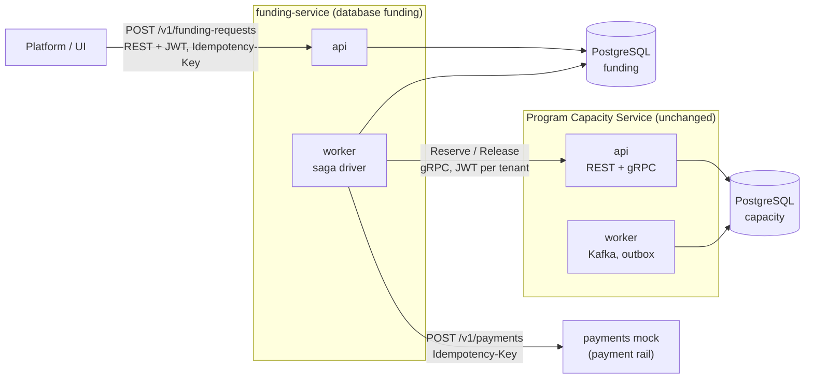
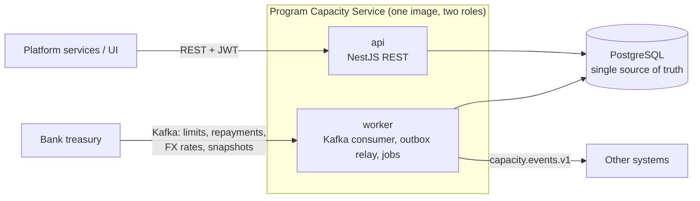

# Program Capacity Service

A backend service that tracks, in real time, how much of a financing program's credit limit
is still available, and **refuses any reservation that would exceed it**, even under heavy
concurrency.

Built as the take-home for a senior Node.js role ([the assignment](docs/Backend-Developer-Test-Assignment.md)).
Stack: Node.js 24, TypeScript, NestJS 12, PostgreSQL 18, Kafka 4.

> **New here?** Read [docs/README.md](docs/README.md): a one-hour reading path through the
> repository, from the business idea to the SQL.

## Why this branch exists

**This is branch `microservices`, an evolution demo. It is not the submission.** The submitted
take-home is [`main`](https://github.com/atamaniuc/program-capacity-service/tree/main): one
modular monolith ([ADR 001](docs/adr/001-modular-monolith-roles.md)) that holds a credit limit
with one PostgreSQL transaction. `main` declined microservices, gRPC, a saga and Kubernetes,
and wrote down for each the condition that would change the answer. This branch makes those
conditions true and builds what the ADRs said would follow, without cutting the capacity
service: its reservation transaction, invariants I1–I8 and REST API stay as they are.

| `main` said | Revisit trigger on `main` | Why it fires here | Branch ADR |
| --- | --- | --- | --- |
| One service ([ADR 021](docs/adr/021-evolution-path.md)) | T3, a new bounded context | Funding decisions become `funding-service`, with its own aggregate and its own database | [023](docs/adr/023-t3-funding-context-database-per-service.md) |
| No gRPC adapter ([ADR 022](docs/adr/022-no-grpc-adapter.md)) | A platform standard of gRPC between services | `funding-service` calls capacity's `Reserve` and `Release` before it pays; REST stays the public API | [024](docs/adr/024-grpc-driving-adapter.md) |
| No saga ([ADR 017](docs/adr/017-out-of-scope.md)) | A multi-step flow across services | Risk check → reserve → disburse → compensate spans two services and a payment rail | [025](docs/adr/025-funding-saga-orchestration.md) |
| No Helm, no cluster ([ADR 017](docs/adr/017-out-of-scope.md)) | A target environment | A local kind cluster runs the whole system | [026](docs/adr/026-helm-and-kind.md) |
| No Pact ([ADR 015](docs/adr/015-contracts.md)) | The first real split | `funding-service` is a real consumer of capacity's contract (after the MVP cut) | [028](docs/adr/028-contracts-package-and-consumer-contracts.md) |
| No API gateway ([ADR 017](docs/adr/017-out-of-scope.md)) | A second public service needing shared policies | `funding-service`'s REST API joins capacity's; in kind, Envoy Gateway routes both and applies JWT, CORS and a per-tenant rate limit, while each service still verifies the token | [029](docs/adr/029-api-gateway.md) |

Still not built here either: Redis, event sourcing, GraphQL, Temporal, a gateway in compose,
a service mesh. The plan, with acceptance criteria and a cut line, is
[specs/0006-funding-saga](specs/0006-funding-saga/spec.md); the layout and the isolation rules
are in [ADR 027](docs/adr/027-repository-layout-and-side-by-side-isolation.md).

### Running it next to `main`

The branch lives in its own worktree and is built to run while `main`'s stack is up:

```bash
git worktree add ../finverity-microservices microservices
cd ../finverity-microservices
```

| | `main` | this branch |
| --- | --- | --- |
| Compose project | `program-capacity` | `program-capacity-ms` |
| PostgreSQL, Kafka, OAuth2 | 5432, 29092, 8081 | 15432, 39092, 18081 |
| Capacity API, api ops, worker ops | 3000, 9464, 9465 | 13000, 19464, 19465 |
| Capacity gRPC (internal, JWT on every call, `127.0.0.1` only) | none | 60051 |
| Funding API, funding api ops, funding worker ops | none | 13100, 19466, 19467 |
| Payments mock (the payment rail) | none | 13200 |
| Prometheus, Grafana, Jaeger, OTLP | 9090, 3001, 16686, 4318 | 19090, 13001, 26686, 14318 |
| Kubernetes | none | kind cluster `finverity-ms`, kubeconfig in `.kind/kubeconfig` (never `~/.kube/config`); port-forwards on 23000-23099 |

**Status.** The minimum viable cut of the branch is built: side-by-side isolation, npm
workspaces, the internal gRPC adapter (lane 0006 tasks T1 to T6); `funding-service` with its
saga, ops ports, metrics, alerts, the runbook entries and `make demo-funding` (T7 to T14); Helm,
kind and the Envoy gateway (T15 to T16a); the contracts package (T18). Open after the cut:
Pact tests (T19, T20), the funding event relay (T21), the operator command for a request that
needs attention (T22) and funding consuming capacity events (T24). The kind job in CI (T23) is
written but has not run yet (see "Kubernetes in CI" below). The
list is in [specs/0006-funding-saga/tasks.md](specs/0006-funding-saga/tasks.md). The sections
below "The problem in one minute" still describe the capacity service as submitted on `main`,
which this branch does not change.

How the branch maps to the job description and the assignment, with proofs and with what is not
covered: [docs/position-fit.md](docs/position-fit.md).

## What this branch adds and how to run it

Capacity is unchanged. Next to it runs a second service that decides whether to pay a supplier
early and has to touch two systems that share no transaction: capacity and a payment rail.



- **`funding-service`** (`services/funding/`): `POST` and `GET /v1/funding-requests`, JWT with
  audience `funding-service`, `Idempotency-Key`, RFC 9457 problems, OpenAPI generated from zod.
  It owns its own PostgreSQL database and role ([ADR 023](docs/adr/023-t3-funding-context-database-per-service.md)).
- **A saga** in the funding worker ([ADR 025](docs/adr/025-funding-saga-orchestration.md)): risk
  check, then `Reserve` on capacity over gRPC, then `Disburse` on the rail, and on a definite
  payment failure a compensating `Release`. State is in PostgreSQL; every step has a
  deterministic idempotency key (`funding:<id>:reserve`, `:disburse`, `:release`), so a retry is
  the same request to the receiver. An unknown outcome of the payment is never compensated: the
  request is parked as `NEEDS_ATTENTION` with the capacity still held, and an alert fires.
- **Internal gRPC on capacity** ([ADR 024](docs/adr/024-grpc-driving-adapter.md)): the same use
  cases as REST behind one boundary module; the same acceptance cases pass over both transports.
- **`payments-mock`** (`services/payments-mock/`): an in-memory payment rail with idempotency
  keys and fault markers in the invoice id (`FAULT-DECLINE`, `FAULT-TIMEOUT`, `FAULT-5XX-<n>`).
- **Helm, kind and an Envoy gateway** ([ADR 026](docs/adr/026-helm-and-kind.md),
  [ADR 029](docs/adr/029-api-gateway.md)): `make kind-up` builds three images and installs five
  Helm releases (local infrastructure, capacity, funding, Envoy Gateway, the gateway policies)
  into a local cluster.
- **Operations**: funding ops ports with `/health/live`, `/health/ready` and `/metrics`, three
  Prometheus alerts (`FundingNeedsAttention`, `FundingCompensationStuck`,
  `FundingReserveUnresolved`) and a runbook entry for each ([docs/runbook.md](docs/runbook.md)).

Run it (Docker, Node 24, `make`; see "Quick start" below for the requirements):

```bash
make down              # once, if you ran an older version of this branch: the database volume
                       # from before the funding database existed is deleted
make up                # PostgreSQL, Kafka, OAuth2, capacity api and worker, payments mock,
                       # funding migrate, api and worker; returns when all are healthy
make seed              # banks, programs, FX rates (valid 24 h: run again on the day of a demo)
make demo-funding      # six funding scenarios against the live stack
```

`make demo-funding` restarts the funding worker with a 15 second disbursement deadline (the
default is 15 minutes) so the needs-attention path does not take 15 minutes, runs the
scenarios (each may take up to two minutes), prints capacity's `reserved` before and after each one, and restores the worker. It
exits with 1 if any scenario does not end as expected.

| Scenario | How it is triggered | Expected end state | Capacity |
| --- | --- | --- | --- |
| `completed` | a normal invoice | `COMPLETED` | amount held |
| `risk-declined` | amount above the risk limit | `REJECTED` (`risk-declined`) | untouched, never called |
| `insufficient-capacity` | amount above what is available | `REJECTED` (`insufficient-capacity`) | untouched |
| `payment-declined` | invoice id `FAULT-DECLINE…` | `FAILED`, compensated | reserved, then released |
| `rail-unavailable` | invoice id `FAULT-5XX-999…` | `NEEDS_ATTENTION` (`disbursement-unknown`) | held, never released |
| `lost-payment-answer` | invoice id `FAULT-TIMEOUT…` | `COMPLETED` | held; the payment is found again by its key |

By hand, after `make up` and `make seed`:

```bash
FTOKEN=$(make -s token TENANT=bank-a SCOPES="funding:write funding:read")
curl -si -X POST localhost:13100/v1/funding-requests \
  -H "authorization: Bearer $FTOKEN" -H "content-type: application/json" \
  -H "idempotency-key: $(uuidgen)" \
  -d '{"programId":"prg_grand_usd","invoiceId":"INV-FUND-1","amount":{"value":"1000.00","currency":"USD"}}'
# 202 Accepted, Location: /v1/funding-requests/<id>; poll that URL until "state" is COMPLETED
```

The funding API, its errors and the gRPC contract: [docs/api.md](docs/api.md#funding-api-branch-microservices).
The containers and the saga as diagrams: [docs/architecture.md](docs/architecture.md#branch-microservices-funding-the-payment-rail-and-the-grpc-hop).
Ports and services: [docs/local-stack.md](docs/local-stack.md). On a cluster (needs `kind`,
`helm` and `kubectl`):

```bash
make helm-check        # lint, template and validate every chart (no cluster needed)
make kind-up           # cluster finverity-ms, three images, five Helm releases incl. the gateway
make kind-smoke        # in-cluster tests: capacity, funding saga, gateway
make kind-forward      # port-forwards on 23000-23099 for manual calls
make kind-down         # deletes cluster finverity-ms and nothing else
```

**Kubernetes in CI.** `.github/workflows/ci.yml` has a `charts` job (`make helm-check`), builds the
funding and payments-mock images in the `image` job, and a `kind` job that installs kind and runs
`make kind-up` and `make kind-smoke`, the same targets as above, for pushes to `microservices` and
pull requests into it (30 minutes at most; kubectl state is uploaded as an artifact when it fails).
The branch is pushed only at the end of the work, so **none of these jobs has run on GitHub yet**;
the first real run of the `kind` job may still need fixes. What the cluster run covers and what it
does not: [specs/0006-funding-saga/handoff.md](specs/0006-funding-saga/handoff.md).

Not built on this branch: Redis, GraphQL, CQRS, a real cloud, TLS or mTLS between services,
Pact tests and the funding event relay (planned, see the status above). The funding service and
the payments mock use plain `node:http` and zod, not NestJS.

## The problem in one minute

A bank opens a **program** for a buyer with a **credit limit**, say USD 10,000,000. Each
supplier invoice the bank pays early **reserves** part of that limit; when the buyer repays,
the amount is **released**. Limits, repayments, FX rates and periodic full **snapshots** also
arrive from the bank's **treasury** system over Kafka. Programs and invoices can be in
different currencies.

The service must always answer "how much is available?" correctly, never let two
simultaneous requests both take the last dollar, survive retries and duplicate messages, and
keep every bank's data separate. A worked example is in [docs/how-it-works.md](docs/how-it-works.md).

## What the assignment asked, and where it is

| Asked | Where |
| --- | --- |
| Accept reservations | `POST /v1/programs/{id}/reservations`: one PostgreSQL transaction with a row lock on the program, so the limit holds under any concurrency <!-- proof: test/integration/reserve-concurrency.int.test.ts#AC-01 --> |
| Process releases | `POST …/reservations/{id}/releases` (partial or full) and `RepaymentReceived` from Kafka, sharing one code path |
| Expose current availability | `GET /v1/programs/{id}/capacity`, plus reservation lists and the program ledger |
| Capacity data from treasury via Kafka, incl. bulk reconciliation | Worker consumes `treasury.capacity.v1` and `treasury.fx-rates.v1`; snapshots are reconciled with a documented case table <!-- proof: test/integration/reconcile.int.test.ts#AC-08 --> |
| Different currencies | Treasury FX rates, fixed per reservation, exact integer maths, rounding rules per currency (USD 2 decimals, KWD 3) |
| All endpoints authenticated | JWT (OAuth2 client credentials, JWKS), scopes, tenant isolation <!-- proof: test/e2e/auth.e2e.test.ts#AC-13 --> |
| Runnable locally | `make up`: Docker Compose with PostgreSQL, Kafka, an OAuth2 server, the API and the worker <!-- proof: Makefile --> |
| Production code | Idempotency keys, inbox/outbox, dead-letter topics, graceful shutdown, health checks, metrics, traces; 195 tests, 100 of them against real PostgreSQL and Kafka |
| Assumptions and trade-offs documented | [docs/assumptions-and-trade-offs.md](docs/assumptions-and-trade-offs.md) |

## Quick start

### Requirements

| What | Version | Why |
| --- | --- | --- |
| Docker Desktop (macOS, Windows) or Docker Engine (Linux) | any recent; **≥ 4 GB memory** for Docker | PostgreSQL, Kafka, the OAuth2 server, the API and the worker run in containers; the tests start their own through Testcontainers |
| Docker Compose v2 plugin (`docker compose`, not `docker-compose`) | ≥ 2.20 | `make up` uses `up --wait` |
| Node.js and npm | Node 24 (`nvm install 24`) | The CLI tools (seed, token, simulator, demo) and the tests run on your machine |
| `make`, `curl` | any (macOS ships GNU Make 3.81, that is enough) | Every command is a make target; the API tour uses curl |
| `jq` | any; optional | Only `make qa` needs it |

Free ports: 13000 (API), 60051 (gRPC), 15432 (PostgreSQL), 18081 (OAuth2), 19464 (api ops + Swagger UI + AsyncAPI),
19465 (worker ops), 39092 (Kafka), and for the funding services 13100, 13200, 19466 and 19467. `make up-all` also needs
13001, 14318, 18080, 19090 and 26686. `make doctor` checks the capacity ports and says how to fix what is missing; it does not
check the four funding ports.

### Install and run

```bash
make install           # one command: check the machine, npm ci, start the stack, seed it (~2–3 min)
```

It runs `make doctor`, `npm ci`, `make up` (build the image, start everything, wait until
healthy) and `make seed` (3 banks, 6 programs in USD/EUR/AED/KWD, FX rates, ~200 invoices).
`make` on its own lists every command with a one-line description; `make completion` shows how
to turn on tab completion for targets and `TENANT=`/`TOPIC=` values in bash or zsh.

> **FX rates from `make seed` are valid for 24 hours.** On the day of a demo run `make seed`
> again (it is safe to repeat), or a reservation in a foreign currency (EUR invoice on a USD
> program) is refused with `422 fx-rate-unavailable`. Same-currency reservations are unaffected.

Try it:

```bash
TOKEN=$(make -s token TENANT=bank-a)

curl -s localhost:13000/v1/programs/prg_grand_usd/capacity -H "authorization: Bearer $TOKEN"

curl -s -X POST localhost:13000/v1/programs/prg_grand_usd/reservations \
  -H "authorization: Bearer $TOKEN" -H "content-type: application/json" \
  -H "idempotency-key: $(uuidgen)" \
  -d '{"invoiceId":"INV-HELLO-1","amount":{"value":"125000.00","currency":"EUR"}}'
```

More in the [API tour](docs/api.md). Then:

```bash
make demo              # plays every scenario (limit cut, repayments, late snapshot, duplicate
                       # and out-of-order messages, poison message, stale FX) and checks the results
make qa                # 103 QA checks: every endpoint and treasury message, plus DB, Kafka and
                       # metric side effects (test cases in docs/qa.md)
make up-all            # the same stack plus Kafka UI, Prometheus, Grafana and Jaeger, tracing on
make down              # stop and delete everything (the tools too)
```

| URL | What |
| --- | --- |
| <http://localhost:13000/v1/…> | Business API (needs a token). Every container, port and profile: [docs/local-stack.md](docs/local-stack.md) |
| <http://localhost:13100/v1/funding-requests> | Branch only: the funding API (needs a token with a `funding:` scope; no Swagger UI, the contract is `services/funding/contracts/openapi.yaml`) |
| <http://localhost:19466/health/ready>, <http://localhost:19467/health/ready> | Branch only: readiness and `/metrics` of the funding `api` and `worker` |
| <http://localhost:19464/docs> | Swagger UI: **Authorize** (local OAuth2 login, client id = tenant), then **Try it out** on any endpoint (ops port, local only) |
| <http://localhost:19464/docs/asyncapi> | AsyncAPI: every Kafka topic the service reads and writes, with headers, keys and an example per message (`make events` tails `capacity.events.v1` live) |
| <http://localhost:18080> | Kafka UI, after `make up-all` (`make kafka-ui` opens it): topics, every record with key and headers, consumer lag, DLQs; can produce a treasury message ([how to check with it](docs/qa.md#kafka-in-the-browser-kafka-ui)) |
| <http://localhost:19464/health/ready>, `/metrics` | Readiness and Prometheus metrics of `api` (`worker`: port 19465) |
| <http://localhost:13001>, <http://localhost:26686>, <http://localhost:19090> | Grafana (capacity dashboard), Jaeger (traces of api and worker), Prometheus, after `make up-all` |

## How it is built



- **One service, two roles.** The same Docker image runs as `api` (HTTP) or `worker` (Kafka and
  background jobs). Splitting into microservices would break the single transaction that
  protects the limit ([ADR 001](docs/adr/001-modular-monolith-roles.md)).
- **The limit is protected by the database.** Each reserve locks the program row
  (`SELECT … FOR UPDATE`), checks, writes and commits. Two requests can never both see the same
  "available" amount ([ADR 003](docs/adr/003-concurrency-lock-order.md)).
- **Retries and duplicates are harmless.** REST writes accept an `Idempotency-Key`; Kafka
  messages are recorded in an inbox table in the same transaction as their effect.
- **Events are never lost or invented.** Changes write an outbox row in the same transaction;
  the worker publishes it afterwards ([ADR 009](docs/adr/009-outbox-relay-lease.md)).
- **Business rules live in one place.** Hexagonal layout: pure domain code, use cases, and
  adapters for HTTP, Kafka and PostgreSQL. A build check forbids the layers from leaking
  ([ADR 018](docs/adr/018-hexagonal-architecture.md)).

C4 diagrams, the flows step by step and the data model: [docs/architecture.md](docs/architecture.md).
This section describes the capacity service. On branch `microservices` it is one of three
deployables; the others are shown in [What this branch adds](#what-this-branch-adds-and-how-to-run-it).

## Repository map

| Path | What is there |
| --- | --- |
| `src/capacity/domain/` | Pure business rules: `Program`, `Reservation`, `Money`, FX conversion, release split. No framework, no I/O |
| `src/capacity/application/` | Use cases (`reserve-capacity`, `release-reservation`, `apply-treasury-event`, `reconcile-program`, `ingest-fx-rate`, queries) and the ports they need |
| `src/capacity/adapters/in/` | Entry points: HTTP controllers, Kafka consumer, scheduled jobs |
| `src/capacity/adapters/out/` | PostgreSQL repositories and migrations, Kafka outbox relay |
| `src/platform/` | Config, logging, health, telemetry, start-up per role |
| `services/funding/`, `services/payments-mock/` | Branch `microservices`: the funding service (domain, saga driver, REST adapter, PostgreSQL adapters and migrations, ops server) and the mock payment rail. Each has its own `package.json`, tests and Dockerfile |
| `packages/contracts/` | Branch `microservices`: the `.proto` of capacity's gRPC API, the generated stubs, and the JSON Schemas of `capacity.events.v1` and `funding.events.v1` |
| `test/` | Integration, end-to-end, Kafka, fault, property and architecture tests (unit tests sit next to the code) |
| `contracts/` | Generated from the zod schemas: OpenAPI (REST), AsyncAPI (Kafka in and out), a JSON Schema per Kafka message |
| `deploy/` | Docker Compose stack, mock OAuth2 config, Prometheus/Grafana, Kubernetes manifests; on the branch also `helm/` (capacity, funding, local-infra, gateway) and `kind/` |
| `tools/` | Token CLI, treasury simulator, demo, DLQ replay, k6 load script, contract generator |
| `db/seeds/` | Deterministic seed data |
| `docs/` | Everything to read; start at [docs/README.md](docs/README.md) |
| `.harness/`, `specs/`, `AGENTS.md`, `CLAUDE.md`, `.claude/` | The AI-assisted build process; not needed to understand the service ([docs/development-process.md](docs/development-process.md)) |

Every file, its purpose and its layer: [docs/repository-map.md](docs/repository-map.md).

## Checks

```bash
make verify    # lint, types, layer rules, OpenAPI/AsyncAPI drift, unit and property tests (~20 s);
               # on the branch also proto lint/breaking and the same checks in every workspace
make test      # all tests with real PostgreSQL and Kafka via Testcontainers (~4 min, needs Docker)
make qa        # 103 QA checks on the running stack: endpoints, Kafka input, DB and events (docs/qa.md)
make compat    # no breaking contract change against origin/main (oasdiff + message schemas; Docker);
               # what counts as breaking and why: docs/api.md §8
make load      # k6 load test against the running stack
```

<!-- proof: make verify --> <!-- proof: make test -->
Every acceptance criterion in [docs/PRD.md](docs/PRD.md) has a test whose name starts with
its id (`grep -rn "AC-08" test src`). Details: [docs/testing.md](docs/testing.md).
<!-- proof: docs/PRD.md -->

## Load test

`make load` runs [k6](https://k6.io) in Docker against the compose stack on a laptop (macOS,
Apple silicon): a 20 s warm-up that is not measured, then two 30 s phases at 100 requests/s
(80% capacity reads, 20% reserve-then-release pairs, each write with an `Idempotency-Key`). The
run **fails** when the spread phase misses NFR-03 (read p95 < 20 ms, reserve and release p95 <
50 ms). Two consecutive runs:

| Phase | Read p95 | Reserve p95 | Release p95 |
| --- | --- | --- | --- |
| Spread over 6 programs (the normal case) | 3.5–4.3 ms | 18.6–25.2 ms | 21.6–25.4 ms |
| Every request on one program (worst case, 20 writes/s on one row) | 4.4–9.8 ms | 27.5–57.8 ms | 29.4–61.8 ms |

At this rate one program absorbs the writes; its p95 is about twice the spread case, because
the writes queue on the program's row lock. The ceiling of one program was not measured. When
it matters, the scale path is to split one limit into several "capacity buckets"
([PRD §8](docs/PRD.md#8-system-design), not built). Without the warm-up, whichever phase runs
first pays the cold start (JIT, connection pools) and misses the target by a wide margin.
These are laptop runs, useful for comparison, not a benchmark.
<!-- proof: make load -->

## Assumptions and trade-offs (short)

The full list with reasons is in [docs/assumptions-and-trade-offs.md](docs/assumptions-and-trade-offs.md). The main ones:

- **Treasury owns credit limits.** There is no REST endpoint to set a limit; limits arrive
  over Kafka.
- **A limit cut never cancels existing reservations**; the program goes "over limit" and
  refuses new reservations.
- **FX rates come from treasury**, are valid for 24 hours, are fixed at reservation time, and
  conversion rounds up.
- **When treasury's snapshot is missing a reservation it should know, the service holds it
  and raises an alert** rather than releasing capacity on a guess (configurable).
- **Health and metrics are not behind a JWT.** They are on a separate internal port, because
  orchestrators and Prometheus cannot send tokens. Every business endpoint is authenticated.
- **Deliberately not used (on `main`):** gRPC ([why](docs/adr/022-no-grpc-adapter.md)), Redis,
  PgBouncer, Debezium, AWS emulators ([why each](docs/infrastructure-choices.md)), event
  sourcing, sagas, GraphQL ([ADR 017](docs/adr/017-out-of-scope.md)). On branch `microservices`
  gRPC and a saga are built (ADR 024, ADR 025); Redis, event sourcing and GraphQL still are not.

## Running in production (not built here)

| Locally | On AWS |
| --- | --- |
| PostgreSQL in Compose | RDS or Aurora PostgreSQL behind RDS Proxy |
| Kafka in Compose | Amazon MSK with IAM auth over TLS |
| `api` and `worker` containers | ECS Fargate or EKS; manifests in `deploy/k8s/` are a starting point |
| mock OAuth2 server | The bank's identity provider or Cognito |
| Environment variables | Secrets Manager / Parameter Store, injected at start |
| Prometheus, Grafana, Jaeger | ADOT collector → CloudWatch and X-Ray |

Operating notes (alerts, dashboards, what to do when the DLQ grows): [docs/runbook.md](docs/runbook.md).

## How this was built

With AI coding agents working under a written process: requirements first, five milestone
lanes, a test per acceptance criterion, and an independent review of every change touching
money or concurrency. Each milestone gate is logged with a timestamp in
`.harness/4-state/BUDGET.md` (optional reading). Details: [docs/development-process.md](docs/development-process.md). <!-- proof: .harness/4-state/BUDGET.md -->

## License

[MIT](LICENSE)
