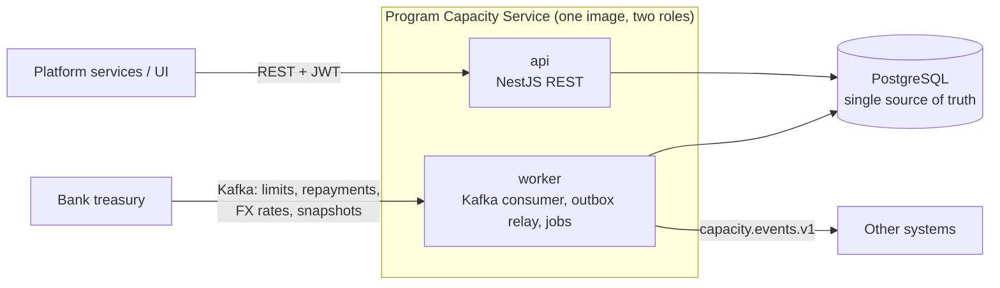

# Program Capacity Service

A backend service that tracks, in real time, how much of a financing program's credit limit
is still available, and **refuses any reservation that would exceed it**, even under heavy
concurrency.

Built as the take-home for a senior Node.js role ([the assignment](docs/Backend-Developer-Test-Assignment.md)).
Stack: Node.js 24, TypeScript, NestJS 12, PostgreSQL 18, Kafka 4.

> **New here?** Read [docs/README.md](docs/README.md): a one-hour reading path through the
> repository, from the business idea to the SQL.

## The problem in one minute

A bank opens a **program** for a buyer with a **credit limit**, say USD 10,000,000. Each
supplier invoice the bank pays early **reserves** part of that limit; when the buyer repays,
the amount is **released**. Limits, repayments, FX rates and periodic full **snapshots** also
arrive from the bank's **treasury** system over Kafka. Programs and invoices can be in
different currencies.

The service must always answer "how much is available?" correctly, never let two
simultaneous requests both take the last dollar, survive retries and duplicate messages, and
keep every bank's data separate. A worked example is in [docs/how-it-works.md](docs/how-it-works.md).

## What the assignment asked, and where it is

| Asked | Where |
| --- | --- |
| Accept reservations | `POST /v1/programs/{id}/reservations`: one PostgreSQL transaction with a row lock on the program, so the limit holds under any concurrency <!-- proof: test/integration/reserve-concurrency.int.test.ts#AC-01 --> |
| Process releases | `POST …/reservations/{id}/releases` (partial or full) and `RepaymentReceived` from Kafka, sharing one code path |
| Expose current availability | `GET /v1/programs/{id}/capacity`, plus reservation lists and the program ledger |
| Capacity data from treasury via Kafka, incl. bulk reconciliation | Worker consumes `treasury.capacity.v1` and `treasury.fx-rates.v1`; snapshots are reconciled with a documented case table <!-- proof: test/integration/reconcile.int.test.ts#AC-08 --> |
| Different currencies | Treasury FX rates, fixed per reservation, exact integer maths, rounding rules per currency (USD 2 decimals, KWD 3) |
| All endpoints authenticated | JWT (OAuth2 client credentials, JWKS), scopes, tenant isolation <!-- proof: test/e2e/auth.e2e.test.ts#AC-13 --> |
| Runnable locally | `make up`: Docker Compose with PostgreSQL, Kafka, an OAuth2 server, the API and the worker <!-- proof: Makefile --> |
| Production code | Idempotency keys, inbox/outbox, dead-letter topics, graceful shutdown, health checks, metrics, traces; 195 tests, 100 of them against real PostgreSQL and Kafka |
| Assumptions and trade-offs documented | [docs/assumptions-and-trade-offs.md](docs/assumptions-and-trade-offs.md) |

## Quick start

### Requirements

| What | Version | Why |
| --- | --- | --- |
| Docker Desktop (macOS, Windows) or Docker Engine (Linux) | any recent; **≥ 4 GB memory** for Docker | PostgreSQL, Kafka, the OAuth2 server, the API and the worker run in containers; the tests start their own through Testcontainers |
| Docker Compose v2 plugin (`docker compose`, not `docker-compose`) | ≥ 2.20 | `make up` uses `up --wait` |
| Node.js and npm | Node 24 (`nvm install 24`) | The CLI tools (seed, token, simulator, demo) and the tests run on your machine |
| `make`, `curl` | any (macOS ships GNU Make 3.81, that is enough) | Every command is a make target; the API tour uses curl |
| `jq` | any; optional | Only `make qa` needs it |

Free ports: 3000 (API), 5432 (PostgreSQL), 8081 (OAuth2), 9464 (api ops + Swagger UI + AsyncAPI),
9465 (worker ops), 29092 (Kafka). `make doctor` checks all of the above and says how to fix
what is missing.

### Install and run

```bash
make install           # one command: check the machine, npm ci, start the stack, seed it (~2–3 min)
```

It runs `make doctor`, `npm ci`, `make up` (build the image, start everything, wait until
healthy) and `make seed` (3 banks, 6 programs in USD/EUR/AED/KWD, FX rates, ~200 invoices).
`make` on its own lists every command with a one-line description; `make completion` shows how
to turn on tab completion for targets and `TENANT=`/`TOPIC=` values in bash or zsh.

> **FX rates from `make seed` are valid for 24 hours.** On the day of a demo run `make seed`
> again (it is safe to repeat), or a reservation in a foreign currency (EUR invoice on a USD
> program) is refused with `422 fx-rate-unavailable`. Same-currency reservations are unaffected.

Try it:

```bash
TOKEN=$(make -s token TENANT=bank-a)

curl -s localhost:3000/v1/programs/prg_grand_usd/capacity -H "authorization: Bearer $TOKEN"

curl -s -X POST localhost:3000/v1/programs/prg_grand_usd/reservations \
  -H "authorization: Bearer $TOKEN" -H "content-type: application/json" \
  -H "idempotency-key: $(uuidgen)" \
  -d '{"invoiceId":"INV-HELLO-1","amount":{"value":"125000.00","currency":"EUR"}}'
```

More in the [API tour](docs/api.md). Then:

```bash
make demo              # plays every scenario (limit cut, repayments, late snapshot, duplicate
                       # and out-of-order messages, poison message, stale FX) and checks the results
make qa                # 103 QA checks: every endpoint and treasury message, plus DB, Kafka and
                       # metric side effects (test cases in docs/qa.md)
make down              # stop and delete everything
```

| URL | What |
| --- | --- |
| <http://localhost:3000/v1/…> | Business API (needs a token) |
| <http://localhost:9464/docs> | Swagger UI: **Authorize** (local OAuth2 login, client id = tenant), then **Try it out** on any endpoint (ops port, local only) |
| <http://localhost:9464/docs/asyncapi> | AsyncAPI: every Kafka topic the service reads and writes, with headers, keys and an example per message (`make events` tails `capacity.events.v1` live) |
| <http://localhost:9464/health/ready>, `/metrics` | Readiness and Prometheus metrics of `api` (`worker`: port 9465) |
| <http://localhost:3001> | Grafana, after `docker compose -f deploy/compose.yaml --profile observability up -d` (Jaeger on 16686) |

## How it is built



- **One service, two roles.** The same Docker image runs as `api` (HTTP) or `worker` (Kafka and
  background jobs). Splitting into microservices would break the single transaction that
  protects the limit ([ADR 001](docs/adr/001-modular-monolith-roles.md)).
- **The limit is protected by the database.** Each reserve locks the program row
  (`SELECT … FOR UPDATE`), checks, writes and commits. Two requests can never both see the same
  "available" amount ([ADR 003](docs/adr/003-concurrency-lock-order.md)).
- **Retries and duplicates are harmless.** REST writes accept an `Idempotency-Key`; Kafka
  messages are recorded in an inbox table in the same transaction as their effect.
- **Events are never lost or invented.** Changes write an outbox row in the same transaction;
  the worker publishes it afterwards ([ADR 009](docs/adr/009-outbox-relay-lease.md)).
- **Business rules live in one place.** Hexagonal layout: pure domain code, use cases, and
  adapters for HTTP, Kafka and PostgreSQL. A build check forbids the layers from leaking
  ([ADR 018](docs/adr/018-hexagonal-architecture.md)).

C4 diagrams, the flows step by step and the data model: [docs/architecture.md](docs/architecture.md).

## Repository map

| Path | What is there |
| --- | --- |
| `src/capacity/domain/` | Pure business rules: `Program`, `Reservation`, `Money`, FX conversion, release split. No framework, no I/O |
| `src/capacity/application/` | Use cases (`reserve-capacity`, `release-reservation`, `apply-treasury-event`, `reconcile-program`, `ingest-fx-rate`, queries) and the ports they need |
| `src/capacity/adapters/in/` | Entry points: HTTP controllers, Kafka consumer, scheduled jobs |
| `src/capacity/adapters/out/` | PostgreSQL repositories and migrations, Kafka outbox relay |
| `src/platform/` | Config, logging, health, telemetry, start-up per role |
| `test/` | Integration, end-to-end, Kafka, fault, property and architecture tests (unit tests sit next to the code) |
| `contracts/` | Generated from the zod schemas: OpenAPI (REST), AsyncAPI (Kafka in and out), a JSON Schema per Kafka message |
| `deploy/` | Docker Compose stack, mock OAuth2 config, Prometheus/Grafana, Kubernetes manifests |
| `tools/` | Token CLI, treasury simulator, demo, DLQ replay, k6 load script, contract generator |
| `db/seeds/` | Deterministic seed data |
| `docs/` | Everything to read; start at [docs/README.md](docs/README.md) |
| `.harness/`, `specs/`, `AGENTS.md`, `CLAUDE.md`, `.claude/` | The AI-assisted build process; not needed to understand the service ([docs/development-process.md](docs/development-process.md)) |

Every file, its purpose and its layer: [docs/repository-map.md](docs/repository-map.md).

## Checks

```bash
make verify    # lint, types, layer rules, OpenAPI/AsyncAPI drift, unit and property tests (~20 s)
make test      # all tests with real PostgreSQL and Kafka via Testcontainers (~4 min, needs Docker)
make qa        # 103 QA checks on the running stack: endpoints, Kafka input, DB and events (docs/qa.md)
make compat    # no breaking contract change against origin/main (oasdiff + message schemas; Docker);
               # what counts as breaking and why: docs/api.md §8
make load      # k6 load test against the running stack
```

<!-- proof: make verify --> <!-- proof: make test -->
Every acceptance criterion in [docs/PRD.md](docs/PRD.md) has a test whose name starts with
its id (`grep -rn "AC-08" test src`). Details: [docs/testing.md](docs/testing.md).
<!-- proof: docs/PRD.md -->

## Load test

`make load` runs [k6](https://k6.io) in Docker against the compose stack on a laptop (macOS,
Apple silicon): a 20 s warm-up that is not measured, then two 30 s phases at 100 requests/s
(80% capacity reads, 20% reserve-then-release pairs, each write with an `Idempotency-Key`). The
run **fails** when the spread phase misses NFR-03 (read p95 < 20 ms, reserve and release p95 <
50 ms). Two consecutive runs:

| Phase | Read p95 | Reserve p95 | Release p95 |
| --- | --- | --- | --- |
| Spread over 6 programs (the normal case) | 3.5–4.3 ms | 18.6–25.2 ms | 21.6–25.4 ms |
| Every request on one program (worst case, 20 writes/s on one row) | 4.4–9.8 ms | 27.5–57.8 ms | 29.4–61.8 ms |

At this rate one program absorbs the writes; its p95 is about twice the spread case, because
the writes queue on the program's row lock. The ceiling of one program was not measured. When
it matters, the scale path is to split one limit into several "capacity buckets"
([PRD §8](docs/PRD.md#8-system-design), not built). Without the warm-up, whichever phase runs
first pays the cold start (JIT, connection pools) and misses the target by a wide margin.
These are laptop runs, useful for comparison, not a benchmark.
<!-- proof: make load -->

## Assumptions and trade-offs (short)

The full list with reasons is in [docs/assumptions-and-trade-offs.md](docs/assumptions-and-trade-offs.md). The main ones:

- **Treasury owns credit limits.** There is no REST endpoint to set a limit; limits arrive
  over Kafka.
- **A limit cut never cancels existing reservations**; the program goes "over limit" and
  refuses new reservations.
- **FX rates come from treasury**, are valid for 24 hours, are fixed at reservation time, and
  conversion rounds up.
- **When treasury's snapshot is missing a reservation it should know, the service holds it
  and raises an alert** rather than releasing capacity on a guess (configurable).
- **Health and metrics are not behind a JWT.** They are on a separate internal port, because
  orchestrators and Prometheus cannot send tokens. Every business endpoint is authenticated.
- **Deliberately not used:** gRPC ([why](docs/adr/022-no-grpc-adapter.md)), Redis, PgBouncer,
  Debezium, AWS emulators ([why each](docs/infrastructure-choices.md)), event sourcing,
  sagas, GraphQL ([ADR 017](docs/adr/017-out-of-scope.md)).

## Running in production (not built here)

| Locally | On AWS |
| --- | --- |
| PostgreSQL in Compose | RDS or Aurora PostgreSQL behind RDS Proxy |
| Kafka in Compose | Amazon MSK with IAM auth over TLS |
| `api` and `worker` containers | ECS Fargate or EKS; manifests in `deploy/k8s/` are a starting point |
| mock OAuth2 server | The bank's identity provider or Cognito |
| Environment variables | Secrets Manager / Parameter Store, injected at start |
| Prometheus, Grafana, Jaeger | ADOT collector → CloudWatch and X-Ray |

Operating notes (alerts, dashboards, what to do when the DLQ grows): [docs/runbook.md](docs/runbook.md).

## How this was built

With AI coding agents working under a written process: requirements first, five milestone
lanes, a test per acceptance criterion, and an independent review of every change touching
money or concurrency. Each milestone gate is logged with a timestamp in
`.harness/4-state/BUDGET.md` (optional reading). Details: [docs/development-process.md](docs/development-process.md). <!-- proof: .harness/4-state/BUDGET.md -->

## License

[MIT](LICENSE)
