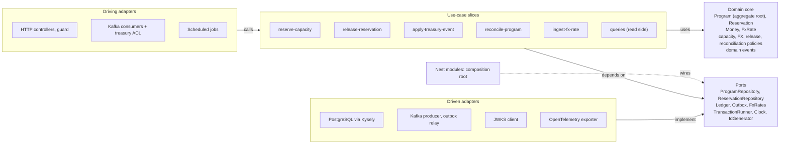
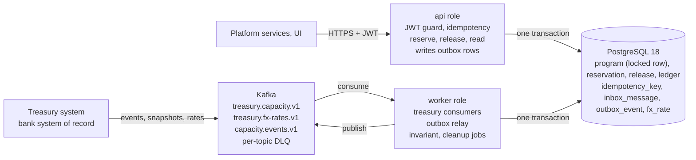

# Program Capacity Service — PRD

> **Branch `microservices`.** This PRD describes `main`, the submitted service. On branch
> `microservices` (an evolution demo) ADRs 023–028 supersede FR-16 and the "won't build" items
> Saga, Helm and Pact of §10 and §11 for that branch only; the requirements, invariants I1–I8 (§6)
> and acceptance criteria of the capacity service are unchanged. See
> [specs/0006-funding-saga/spec.md](../specs/0006-funding-saga/spec.md).

Oct 28, 2026

## 1. Context and problem

The Program Capacity Service keeps the real-time credit capacity of every supply chain finance (SCF) program and refuses any reservation that would exceed it.

- A **program** is a funder's facility for one buyer's suppliers, with a total credit limit in one currency, e.g. USD 10,000,000.
- When an invoice is **approved for early payment**, it **reserves** part of that limit. When the buyer **repays**, the reservation is **released**. Available = limit − active reservations.
- Two writers change the same state: platform services through a synchronous API, and the bank's **treasury** system through Kafka (limit changes, repayments and periodic **bulk reconciliation** snapshots of a program's full state).
- Programs and invoices may be in different currencies, so every reservation is converted into the program currency at a recorded rate.

Over-reserving means a funder pays out money it never approved. Under-reserving blocks suppliers who are entitled to finance. Either one costs bank trust, the asset a white-label SCF platform sells.

Inputs: the test assignment *Program Capacity & Invoice Reservation* and the *Senior Node.js Engineer* job description, both in this project.

## 2. Goals, non-goals and success criteria

The deliverable is one production-grade service whose correctness under concurrency, retries and late data can be shown in a 60–90 minute CTO review.

**Goals**

- **G1.** Never over-reserve a program's limit, including under concurrent requests and duplicate or late messages.
- **G2.** Make every capacity change explainable: who, why, which request or message, and the balance after.
- **G3.** Treat treasury as the system of record without losing reservations made in flight.
- **G4.** Support multi-currency invoices with recorded rates and exact releases.
- **G5.** Run locally with one command and prove G1–G4 with automated tests.
- **G6.** Show the production habits the job description asks for: API design, idempotency, security, observability, CI.

**Non-goals**

- Invoice approval, funding decisions, disbursement, pricing and discount calculation.
- Limits other than the single program limit (buyer, supplier or country sub-limits).
- FX revaluation (mark-to-market) of existing reservations.
- UI, multi-region deployment, a real cloud environment.

**Success criteria**

| # | Criterion | Evidence |
| --- | --- | --- |
| S1 | 50 parallel reservations on a limit that fits 10: exactly 10 succeed | Concurrency test on real PostgreSQL |
| S2 | A retried request or a redelivered Kafka message has one effect | Idempotency tests, one ledger entry |
| S3 | A snapshot older than in-flight reservations does not drop them | Reconciliation test |
| S4 | Partial releases then a final release leave zero remainder in program currency | Property-based test |
| S5 | `docker compose up` plus one script reproduces every demo scenario | README walkthrough |
| S6 | No business endpoint answers without a valid token | Auth e2e tests |
| S7 | CI is green: lint, types, tests, dependency and image scan | GitHub Actions run |
| S8 | Every assumption and trade-off is written down | README and ADRs |

## 3. Actors and critical paths

Three machine clients and one human role use the service. Five critical paths carry the money risk, and each gets its own spec, tests and runbook line.

| Actor | Channel | Uses |
| --- | --- | --- |
| Platform services (invoice and funding workflow) | REST, or the `capacity.events.v1` stream | Reserve, release, read availability |
| Platform UI or BFF (bank operators, supplier portal) | REST | Read availability, list reservations, read the audit trail |
| Treasury system (the bank's system of record) | Kafka, inbound | Limit changes, repayments, FX rates, reconciliation snapshots |
| Downstream consumers (treasury, risk, notifications) | Kafka, outbound | Reservation and capacity events |
| Operator or on-call engineer | Metrics, logs, ops endpoints | Detect drift, over-limit programs, consumer lag, DLQ growth |

**Critical paths**

1. **CP-1 Reserve under contention.** Many reservations hit one program at once.
2. **CP-2 Release.** Full and partial releases, from the API and from repayment events.
3. **CP-3 Limit change.** Treasury raises or cuts a limit, including below what is already reserved.
4. **CP-4 Bulk reconciliation.** A snapshot arrives while reservations are in flight.
5. **CP-5 Multi-currency.** Reserve and release an invoice whose currency differs from the program's.

## 4. Functional requirements

Sixteen requirements cover the assignment; twelve are P0 (priority 0, must have) and form the critical path. Acceptance criteria below are written as Given/When/Then so that agents can turn each row into a named test.

| ID | Requirement | Priority |
| --- | --- | --- |
| FR-01 | **Read capacity.** Return `limit`, `reserved`, `available` (never negative), `overLimitBy`, `utilization`, currency, `version` and the last applied treasury sequence. Reads go to the primary, so a client reads its own writes. | P0 Must |
| FR-02 | **Reserve.** Atomically check and reserve an invoice amount in program currency. One reservation per (program, invoice). Outcomes: created, replayed, conflict, insufficient capacity, program over limit or suspended, FX rate unavailable. | P0 Must |
| FR-03 | **Release.** Release fully or partially with reason `REPAID` or `CANCELLED`. Never above the remaining amount. The final release takes the exact remainder. | P0 Must |
| FR-04 | **Idempotent mutations.** Optional `Idempotency-Key` on every POST: tenant-scoped, fingerprinted, stored response. Natural-key dedup still applies when the key is absent. | P0 Must |
| FR-05 | **Treasury limit events.** Create or update a program. A cut below `reserved` puts it over limit: new reservations blocked, releases allowed. | P0 Must |
| FR-06 | **Treasury repayment events.** Release capacity through the same domain path as FR-03. | P0 Must |
| FR-07 | **Bulk reconciliation.** Apply a program snapshot against a watermark, keep in-flight reservations, record every adjustment, raise a drift alert. | P0 Must |
| FR-08 | **FX rates.** Ingest rates from treasury. A reservation uses the latest rate younger than the configured max age and stores rate, source and timestamp. | P0 Must |
| FR-09 | **Kafka processing guarantees.** Dedup by message id, per-program ordering, stale-sequence skip, bounded retries, DLQ with error headers. Commit offsets only after the DB commit. | P0 Must |
| FR-10 | **AuthN and AuthZ.** JWT validated through JWKS on every business endpoint. Scopes `capacity:read` and `capacity:write`. Tenant isolation: another tenant's program returns 404. | P0 Must |
| FR-11 | **Audit ledger.** Append-only entry for every limit or reservation change, with cause, actor and balance after. | P0 Must |
| FR-12 | **Query endpoints.** List reservations with filters and cursor pagination; read the ledger of a program. | P1 Should |
| FR-13 | **Outbound events.** Transactional outbox publishes `ReservationCreated`, `ReservationReleased`, `ProgramCapacityChanged`, `ReconciliationDriftDetected`, keyed by `tenantId:programId` with a per-program sequence. | P1 Should |
| FR-14 | **Ops endpoints.** Liveness, readiness (DB and consumer state) and Prometheus metrics on a separate internal port. | P0 Must |
| FR-15 | **Invariant check.** A scheduled job recomputes reserved totals from active reservations and the ledger and reports any mismatch. | P1 Should |
| FR-16 | **gRPC adapter — declined (ADR 022).** Considered as a P2 driving adapter over the same use cases; not built because no client needs it and a second transport would duplicate validation, auth and error mapping. Revisit triggers are in ADR 022. | Won't (this release) |

**Acceptance criteria for the critical path**

| AC | FR | Given | When | Then |
| --- | --- | --- | --- | --- |
| AC-01 | FR-02 | USD program, limit 10,000,000, reserved 9,000,000 | 50 concurrent reservations of 100,000 for distinct invoices | Exactly 10 succeed, 40 get insufficient capacity, reserved = 10,000,000 |
| AC-02 | FR-04 | Reservation created with `Idempotency-Key` K | The same body is sent again with K, also concurrently while the first is still running | The stored 201 response is returned; the ledger holds one entry |
| AC-03 | FR-04 | Reservation created with key K | A different body is sent with K | 422; nothing changes |
| AC-04 | FR-02 | INV-1 reserved for EUR 1,000,000 | A reserve for INV-1 arrives without a key: same amount, then a different amount | Same amount: 200 with the existing reservation. Different amount: 409 |
| AC-05 | FR-03 | USD 1,100,000.00 reserved for EUR 1,000,000.00 | Releases of EUR 333,333.33, 333,333.33 and 333,333.34 | Released program amounts sum to exactly USD 1,100,000.00; status `RELEASED` |
| AC-06 | FR-03 | Active reservation with remainder R and a release `X` already applied | A release above R; `X` again with the same body; `X` with a different amount | Above R: 422, no change. Same body: original result, no change. Different body: 422 `release-ref-mismatch` |
| AC-07 | FR-05 | Limit 10,000,000, reserved 3,620,000 | Treasury sets the limit to 3,000,000 | `available` = 0, `overLimitBy` = 620,000; new reservations rejected, releases succeed |
| AC-08 | FR-07 | Snapshot seq 41 with watermark 57 omits INV-4, created by platform event 58 | The snapshot is applied | INV-4 stays active; reserved = snapshot total + INV-4 |
| AC-09 | FR-09 | Program at treasury seq 42 | An event or snapshot with seq ≤ 42 arrives | Skipped, logged and committed; no state change |
| AC-10 | FR-09 | Message M already processed | M is redelivered | No state change; offset committed |
| AC-11 | FR-09 | A message fails schema validation | It is consumed | It lands in the DLQ with the error; the partition keeps moving |
| AC-12 | FR-08 | Newest EUR/USD rate is older than the max age | A EUR reservation arrives | 422 `fx-rate-unavailable`; nothing reserved |
| AC-13 | FR-10 | Token for tenant A with scope `capacity:read` | It reads tenant B's program; it reserves; a call has no token | 404; 403; 401 |
| AC-14 | FR-07 | Snapshot shows INV-5 with the same outstanding invoice amount and a program amount 1 minor unit away from ours | The snapshot is applied | No adjustment; a `within-tolerance` drift line is logged |
| AC-15 | FR-07 | Snapshot shows INV-5 with a different outstanding invoice amount, or a program amount beyond tolerance | The snapshot is applied | Treasury wins: `RECON_ADJUST` ledger entry and `ReconciliationDriftDetected` |
| AC-16 | FR-10 | Tenants A and B each have a program with id `grand-usd` | Tenant A reserves on `grand-usd` | Only tenant A's program changes |
| AC-17 | FR-04 | A reserve under key K was rejected with 422 insufficient capacity | The same body is sent with K after capacity was freed | The stored 422 is replayed; a new key is needed for a new attempt |

## 5. Non-functional requirements

Correctness and auditability outrank speed: SCF volumes are thousands of invoices a day per bank, not thousands per second. Latency figures below are targets to measure, not promises.

| ID | Area | Requirement | Verified by |
| --- | --- | --- | --- |
| NFR-01 | Correctness | Invariants I1–I8 (section 6) hold under concurrency, retries and a crash between any two steps | Concurrency, property-based and fault-injection tests |
| NFR-02 | Consistency | A state change, its ledger entry, its inbox mark and its outbox event commit in one PostgreSQL transaction | Code review checklist; crash test |
| NFR-03 | Latency (target) | Local stack at 100 req/s mixed load: capacity read p95 ≤ 20 ms, reserve and release p95 ≤ 50 ms | k6 script |
| NFR-04 | Contention | Throughput of one hot program is measured and documented; the scale path is described | k6 result; ADR |
| NFR-05 | Freshness (target) | Treasury events applied within 5 s p95 under normal load; consumer lag exported | Metric and dashboard |
| NFR-06 | Resilience | A Kafka outage does not stop the REST API; the outbox drains on recovery. A DB outage turns readiness false and returns 503 | Integration tests with stopped containers |
| NFR-07 | Shutdown | On SIGTERM: stop intake, finish in-flight requests and messages, commit offsets, close the pool within 25 s | Integration test |
| NFR-08 | Security | JWKS-validated JWT (issuer, audience, expiry, clock skew); config validated at boot; no secrets in git; non-root image; validation on every boundary; RFC 9457 errors without internals | Tests; CI scans |
| NFR-09 | Auditability | Every change carries request or message id, actor and tenant. Ledger rows are never updated or deleted, enforced in the database | DB grants or trigger test |
| NFR-10 | Observability | JSON logs with trace id; RED and domain metrics; OpenTelemetry traces across HTTP, PostgreSQL and Kafka; dashboard and alert rules as code | Local observability profile |
| NFR-11 | Retention | Idempotency keys kept at least 24 h, published in API docs; inbox at least 7 days; ledger and reservations kept | Cleanup job test |
| NFR-12 | Portability | `docker compose up` on macOS arm64 and Linux amd64; tests use Testcontainers; no cloud account | CI on Linux; README |
| NFR-13 | Maintainability | Strict TypeScript; domain layer has no framework imports; at least 90% line coverage in domain and application layers | Lint rule; coverage gate |
| NFR-14 | Compatibility | Versioned API (`/v1`), additive changes within a version; OpenAPI and message schemas committed; CI fails on a breaking diff | Contract diff job |
| NFR-15 | Pooler-safe | No session state (no session advisory locks, no `SET` outside a transaction), so PgBouncer transaction pooling or RDS Proxy works | Review checklist |

## 6. Domain model, money rules and invariants

Eight tables hold the state. The `program` row is the only hot row and the single place where capacity is checked.

| Table | Purpose | Key columns |
| --- | --- | --- |
| `program` | Capacity projection per program; locked by every capacity change | PK (`tenant_id`, `id`) where `id` is treasury's program id, unique only within a tenant; `currency`, `credit_limit_minor`, `reserved_minor`, `status` (ACTIVE, SUSPENDED), `version`, `treasury_seq`, `platform_seq` |
| `reservation` | One per (tenant, program, invoice) | `id` (UUIDv7), `tenant_id`, `program_id`, `invoice_id`, `invoice_amount_minor`, `invoice_currency`, `fx_rate`, `fx_rate_source`, `fx_rate_at`, `amount_minor` (program currency), `released_minor`, `status`, `origin` (API, TREASURY, RECONCILIATION), `platform_seq` |
| `reservation_release` | One per release reference; makes releases idempotent | `reservation_id`, `release_ref`, `fingerprint`, `invoice_amount_minor`, `amount_minor`, `reason` |
| `ledger_entry` | Append-only audit trail behind every number | `tenant_id`, `program_id`, `reservation_id`, `kind` (RESERVE, RELEASE, LIMIT\_SET, RECON\_ADJUST), `delta_reserved_minor`, `delta_limit_minor`, `limit_after`, `reserved_after`, `cause_type`, `cause_id`, `actor`, `created_at` |
| `fx_rate` | Latest treasury rates | `base`, `quote`, `rate` (NUMERIC), `source`, `as_of` |
| `idempotency_key` | HTTP replay store | PK (`tenant_id`, `key`), `fingerprint`, `status_code`, `response_body`, `created_at` |
| `inbox_message` | Kafka dedup | PK (`consumer`, `message_id`), `topic`, `partition`, `offset`, `processed_at` |
| `outbox_event` | Events waiting to be published | `id`, `tenant_id`, `program_id`, `program_seq`, `type`, `payload`, `published_at` |

A reservation moves ACTIVE → PARTIALLY\_RELEASED → RELEASED, or straight from ACTIVE to RELEASED.

**Invariants**

- **I1.** `program.reserved_minor` = Σ (`amount_minor` − `released_minor`) over the program's reservations that are not RELEASED.
- **I2.** A reservation commits only if the program is ACTIVE and `credit_limit_minor` − `reserved_minor` ≥ `amount_minor` at commit time.
- **I3.** 0 ≤ `released_minor` ≤ `amount_minor`; the status follows from these two numbers.
- **I4.** At most one reservation per (`tenant_id`, `program_id`, `invoice_id`) and one release per (`reservation_id`, `release_ref`).
- **I5.** Every change to `reserved_minor` or `credit_limit_minor` has exactly one ledger entry, and ledger sums reproduce the projection.
- **I6.** Every inbound message id has at most one effect per consumer.
- **I7.** `version`, `treasury_seq` and `platform_seq` only grow.
- **I8.** Money is integer minor units plus an ISO 4217 code. No binary floating point anywhere on the path.

**Money and FX rules**

1. JSON carries amounts as decimal strings (`"1250.50"`) with a currency code. The scale is checked against ISO 4217 minor units: JPY 0, USD 2, KWD 3.
2. Storage uses `BIGINT` minor units and `NUMERIC(20,10)` rates. Arithmetic uses `bigint` with the rate as a scaled integer.
3. A reserve converts with the latest rate younger than `FX_MAX_AGE` (default 24 h, an assumption) and rounds **up** to the program's minor unit. The platform never reserves less than the risk it takes.
4. A reservation stores its rate, source and timestamp. Releases never re-read the market rate.
5. A partial release of `repaid` in invoice currency frees floor(`amount_minor` × `repaid` ÷ `invoice_amount_minor`) in program currency. The release that completes the invoice takes the exact remainder, so the releases always sum to `amount_minor`.
6. A same-currency invoice skips conversion and records a rate of 1.

## 7. Architecture style, patterns and ubiquitous language

Hexagonal architecture with vertical use-case slices around one tactical-DDD domain core, in a single Nest application. No monorepo tooling.



Business rules live only in the domain core. A new entry point is one more driving adapter, not a new code path.

| Pattern | Use it? | How, and why |
| --- | --- | --- |
| DDD, strategic | Yes | One bounded context, *Program Capacity*. Treasury is an upstream context behind an anti-corruption layer that translates its messages into domain commands. Platform services are downstream and consume a published language: the REST API and `capacity.events.v1`. |
| DDD, tactical | Yes, light | `Program` is the aggregate root and owns the capacity invariant. `Reservation` is an entity loaded one at a time, never as a full collection. Value objects: `Money`, `Currency`, `FxRate`, typed ids. Domain events become outbox rows. |
| Hexagonal (ports and adapters) | Yes | Three driving adapters (HTTP, Kafka, scheduled jobs) call the same use cases. Persistence and messaging sit behind ports, so domain and slice tests need no containers. |
| Clean Architecture | Only its dependency rule | Hexagonal already makes dependencies point inward. Extra rings and per-layer DTO mappers add ceremony without safety. |
| Vertical slices | Yes, for use cases | One folder per use case: command, handler, schema, tests. Slices share the domain core, never each other's internals. |
| CQRS | Lite, in code only | Commands go through the domain; queries read PostgreSQL through Kysely directly. No separate read store, and no `@nestjs/cqrs` bus for six handlers. |
| Unit of Work | Yes | A `TransactionRunner` port gives each use case one transaction and the fixed lock order. |
| Result type | Yes | Insufficient capacity is an expected outcome, not an exception. The HTTP adapter maps results to problem types. |
| Strategy | Yes | Reconciliation mode (HOLD or RELEASE) and FX rounding are swappable policies. |
| Timeouts | Yes | `lock_timeout` and `statement_timeout` per transaction stop request pile-ups on a hot program row. |
| Idempotent consumer, inbox, outbox, DLQ | Yes | Section 8. |
| Event sourcing, Saga, generic repository | No | Section 10. Generic repositories would hide the locking queries that matter most here. |
| Nx or Nest monorepo | No | One deployable, one package; the simulator is a script in `tools/`. Revisit when a second service or a shared contracts package appears. |

**Enforcement.** dependency-cruiser fails CI when `domain` imports anything outside itself, when `application` imports an adapter, when one adapter imports another, or when a slice imports another slice.

**Evolution: why one service now, and when to split.** The assignment asks for a module. In a microservices platform this module is one service with versioned contracts and an asynchronous boundary through Kafka. Inside it there is one aggregate and one invariant held by one transaction. Splitting reserve, release and reconcile into separate services would break that transaction and force sagas or compensations to protect a risk that today costs one row lock.

| Trigger | What happens | Split |
| --- | --- | --- |
| T1. Team boundary | A separate team owns the treasury integration and needs its own release cycle | Deploy `worker` (ingest, outbox relay, jobs) on its own; it is already a separate process. The shared database is a documented transitional state |
| T2. Tenant isolation | A bank requires its own database or instance, for example for data residency | Cells: the same image, a database per bank, routing by tenant. This partitions the deployment; it is not a new service |
| T3. New bounded context | Funding decisions, reporting or FX become domains of their own | A new service that consumes `capacity.events.v1`; the reservation transaction stays whole |
| T4. Load | Contention on a hot program row | No split: capacity buckets, a read replica, table partitioning |

Order of the split, when a trigger fires:

1. Already in place: `api` and `worker` roles, ports, versioned contracts, inbox and outbox. These are the seams.
2. Move `contracts/` into its own package; every split depends on it.
3. First real split: `worker`, with an ADR on the shared database as a transitional state.
4. Per-tenant cells as the main scaling answer for a white-label platform.
5. New capabilities arrive as new event consumers, never by cutting the reservation transaction.

**Preconditions for any split.** A trigger above has fired and is written down as an ADR; contracts live in their own package; the inbox and outbox already guard the boundary being cut; the AC suite runs against both sides of the split.

**When contract tooling grows.** Today contract control is OpenAPI and AsyncAPI generated from zod, `oasdiff` in CI, and JSON Schema / AsyncAPI validation of simulator output and outbound events (ADR 015): there is one provider and no real consumer to verify against. Consumer-driven contracts (Pact) or a schema registry (Avro or JSON Schema with compatibility rules) appear with the first real split, when a second deployable consumes `capacity.events.v1`.

Never split by write operation while one invariant spans those operations, and never add Redis or a read store without metrics that ask for it.

**Ubiquitous language.** Code, API, events, logs and docs use exactly these words. The glossary lives in `docs/glossary.md`, and agents must not invent synonyms such as *allocation*, *booking* or *balance*.

| Term | Meaning | In code |
| --- | --- | --- |
| Program | A funder's facility for one buyer's suppliers, with one credit limit in one currency | `Program`, `programId` |
| Credit limit | Maximum exposure the program may hold at once | `creditLimit` |
| Reserved | Sum of open reservations, in program currency | `reserved` |
| Available | Credit limit minus reserved, never below zero | `available` |
| Over limit | Reserved exceeds the credit limit after a limit cut | `overLimitBy`, `ProgramOverLimit` |
| Reservation | Capacity held for one invoice approved for early payment | `Reservation`, `reservationId` |
| Release | Returning reserved capacity after repayment or cancellation | `Release`, `releaseRef` |
| Repayment | The buyer pays the invoice to the funder; treasury reports it | `RepaymentReceived` |
| Invoice amount, reserved amount | The amount in invoice currency, and its conversion into program currency | `invoiceAmount`, `reservedAmount` |
| FX rate | Rate from invoice currency to program currency, fixed at reservation | `FxRate` |
| Treasury | The bank's system of record for limits and settled state | `treasury` adapter namespace |
| Snapshot | Treasury's full state of one program at a sequence number | `ProgramReconciled` |
| Watermark | Highest platform event sequence treasury had applied when it took a snapshot | `platformWatermark` |
| Drift | A difference between a snapshot and the platform's state | `ReconciliationDriftDetected` |
| Tenant | A bank using the platform | `tenantId` |
| Ledger entry | Immutable record of one change to the limit or to reserved | `LedgerEntry` |

## 8. System design

One NestJS codebase ships as one image with two runtime roles. PostgreSQL row locks and unique constraints enforce every invariant; Kafka only carries facts in and out.



The `api` role never calls Kafka: it writes outbox rows in the same transaction as the change, and the `worker` relays them.

**Components**

- **`api` role.** REST controllers, JWT guard, idempotency handling, application services.
- **`worker` role.** Treasury consumers (capacity and FX topics), outbox relay, scheduled jobs (invariant check, retention cleanup).
- **Shared core.** Domain in plain TypeScript (Money, Program, Reservation policies), application services with one transaction per use case, adapters for PostgreSQL, Kafka and JWKS.
- `APP_ROLE=api|worker|all` selects the role. Compose runs `api` and `worker` as separate containers to show independent scaling and failure isolation.

**Lock order.** Every writer takes locks in the same order: dedup row (idempotency key or inbox row), then the `program` row, then reservation rows. Writers therefore cannot deadlock each other.

**Reserve (CP-1, CP-5)**, one transaction at READ COMMITTED:

1. The guard checks the JWT, scope `capacity:write` and tenant; zod validates the body. Validation and auth errors return before any key is taken, so the client can fix the request and reuse the key.
2. With an `Idempotency-Key`, insert (`tenant_id`, `key`, `fingerprint`) with `ON CONFLICT DO NOTHING RETURNING`.
   - If another transaction holds an uncommitted row for the same key, PostgreSQL makes this insert wait until that transaction ends ([index uniqueness checks](https://www.postgresql.org/docs/current/index-unique-checks.html)). Reproduced on PostgreSQL 16: the duplicate waited 2.5 s for the winner.
   - Winner committed: the insert returns no row. A new statement reads the committed key row and replays its stored response, or returns 422 on a fingerprint mismatch.
   - Winner rolled back: the insert succeeds and this request does the work.
   - No lease or in-progress state is needed, because the operation makes no external call ([DB-only variant](https://habr.com/ru/companies/otus/articles/1095234/)).
3. `SELECT … FOR UPDATE` the program by (`tenant_id`, `id`). Missing: 404.
4. Look up an existing reservation for the invoice. Same terms: replay with 200. Different terms: 409.
5. Convert with the newest valid FX rate, rounding up. Check `ACTIVE` and `limit − reserved ≥ amount`. On failure, store the 422 problem as the key's response, change nothing else and commit, so a retry with the same key replays the same answer.
6. Insert the reservation, update the program (`reserved`, `version`, `platform_seq`), append the ledger entry and the outbox event, store the idempotency response, commit. An infrastructure failure rolls everything back, including the key, so a retry runs again.

The unique index on (`program_id`, `invoice_id`), a `CHECK (reserved_minor >= 0)` and a `WHERE credit_limit_minor - reserved_minor >= :amount` guard on the update back up the application check.

**Release (CP-2).** Same lock order. Insert into `reservation_release` with `ON CONFLICT (reservation_id, release_ref) DO NOTHING`. A repeat with the same body replays the stored result; the same `release_ref` with a different amount or reason returns 422 `release-ref-mismatch`, the same rule as `Idempotency-Key`. Compute the program amount (floor, or the exact remainder on the final release), update reservation and program, append ledger and outbox, commit.

**Treasury consumer (CP-3, FR-09)**

1. Messages are keyed by `tenantId:programId`. One message in flight per partition keeps per-program order; partitions run in parallel.
2. Validate envelope and payload with zod. Invalid: publish to the DLQ topic with error headers, then commit the offset. A crash between those two steps can put the same message in the DLQ twice, so DLQ tooling dedups by `messageId`.
3. In one transaction: insert the inbox row (duplicate: skip), lock the program, skip if `seq ≤ treasury_seq`, apply the change, set `treasury_seq`, append ledger and outbox, commit.
4. Commit the Kafka offset only after the DB commit. A crash between the two replays the message, and the inbox absorbs it.
5. Transient failures (database down) pause the partition and retry with backoff. Permanent failures (unknown reservation in a repayment) go to the DLQ and raise an alert.
6. `make dlq-replay` republishes fixed DLQ messages to the source topic; the inbox makes the replay safe.

**Reconciliation (CP-4).** A snapshot carries `seq`, `asOf`, the limit, every open reservation with its outstanding amount in invoice currency and in program currency, and `platformWatermark`.

- **Watermark contract.** `platformWatermark` = N means treasury has applied every platform event 1..N for this program: a contiguous prefix, not the highest number it has seen. Platform events carry a gap-free per-program `platform_seq`, so treasury can compute it.
- **Fallback without a watermark.** Compare `asOf` with reservation creation time, using a clock-skew margin. This is a degraded mode: every use raises a `reconciliation_fallback` alert.
- **Amount comparison.** Outstanding amounts are compared in invoice currency first, which involves no FX. Program-currency differences up to `RECON_TOLERANCE_MINOR` (default 1 minor unit per reservation) are logged and left alone; only larger differences let treasury win. Without a tolerance, every snapshot would rewrite cents forever.
- **Lock time.** The service loads the snapshot into a staging table and computes the diff outside the program lock. Under the lock it re-checks `version`, recomputes if the program moved, and applies only the diff with set-based statements. Writers wait milliseconds, not the length of the snapshot. Snapshots above `RECON_MAX_RESERVATIONS` (default 50,000) go to the DLQ with an alert.

| Case | Action | Recorded as |
| --- | --- | --- |
| Snapshot `seq` ≤ `treasury_seq` | Skip as stale | Log line |
| Limit differs | Treasury wins | `LIMIT_SET` |
| Reservation in both, difference within tolerance | Keep ours | within-tolerance log line |
| Reservation in both, outstanding invoice amount differs or program amount beyond tolerance | Treasury wins | `RECON_ADJUST` + drift event |
| Reservation only in the snapshot | Adopt it with origin `TREASURY` | `RECON_ADJUST` + drift event |
| Only ours, `platform_seq` > watermark | Keep: treasury has not seen it yet | Nothing |
| Only ours, `platform_seq` ≤ watermark | Default HOLD: keep it reserved and alert for review; a config switch can release instead | Drift event |

Treasury wins wherever it has an opinion. Where it is silent about something it should know, the service keeps the larger exposure, because over-reserving delays a supplier while under-reserving loses a funder's money.

**Outbox relay (P1).** Only the worker holding the relay lease publishes, which keeps per-program order. The lease row has an owner, an epoch and `expires_at` (TTL 30 s, renewed every batch). A crashed or stuck holder loses it after the TTL and another worker takes over with a higher epoch. A stale holder's late "mark published" is rejected because its epoch no longer matches; anything it already sent is a duplicate that consumers drop by event id. Delivery is at least once; consumers dedup by event id and order by `program_seq`.

**Scheduled jobs.** The invariant check runs every 5 minutes. Retention cleanup removes idempotency keys older than 24 h, and inbox rows and published outbox rows older than 7 days.

**Scale path (documented, not built).** Split a hot program's limit into capacity buckets, serve list endpoints from a read replica, partition tables by tenant.

## 9. Interfaces

The public contract is a versioned REST API plus versioned Kafka topics. Programs have no create endpoint: they come from treasury events, and seeds create them locally.

**REST API** (`/v1`, JSON, errors as RFC 9457 `application/problem+json`)

| Method and path | Purpose | Scope | Notes |
| --- | --- | --- | --- |
| `GET /v1/programs/{programId}/capacity` | Current availability | `capacity:read` | `ETag` = `version` |
| `POST /v1/programs/{programId}/reservations` | Reserve for an invoice | `capacity:write` | Optional `Idempotency-Key`; 201, 200 replay, 409, 422 |
| `GET /v1/programs/{programId}/reservations/{reservationId}` | One reservation with its releases | `capacity:read` |  |
| `GET /v1/programs/{programId}/reservations` | List by `invoiceId`, `status`; cursor pagination | `capacity:read` | P1 |
| `POST /v1/programs/{programId}/reservations/{reservationId}/releases` | Full or partial release | `capacity:write` | Body: `releaseRef`, optional `amount` (default: remainder), `reason` |
| `GET /v1/programs/{programId}/ledger` | Audit trail, cursor pagination | `capacity:read` | P1 |
| `GET /health/live`, `/health/ready`, `/metrics` | Ops | none | Internal port only (`:9464`), never routed by ingress |

Problem types: `insufficient-capacity`, `program-over-limit`, `program-suspended`, `fx-rate-unavailable`, `reservation-conflict` (409), `idempotency-key-mismatch` (422), `release-ref-mismatch` (422), `release-exceeds-remaining` (422), `validation-error` (400), `not-found` (404). Clients branch on `type`, not on status. A business rejection given under an `Idempotency-Key` is stored and replayed for that key; keys are kept at least 24 h, and the API docs say so.

```json
POST /v1/programs/prg_grand_usd/reservations
Authorization: Bearer <jwt>
Idempotency-Key: 6f1c0e2a-9d7b-4c1e-8a55-0b3c2f1d7e90

{ "invoiceId": "INV-1003", "amount": { "value": "1000000.00", "currency": "EUR" } }

201 Created
{ "reservationId": "0192f7c4-…", "status": "ACTIVE",
  "invoiceAmount": { "value": "1000000.00", "currency": "EUR" },
  "reservedAmount": { "value": "1080000.00", "currency": "USD" },
  "fx": { "rate": "1.0800000000", "source": "treasury", "asOf": "2026-10-28T09:00:00Z" },
  "capacity": { "limit": "10000000.00", "reserved": "7280000.00", "available": "2720000.00", "version": 58 } }
```

**Kafka topics** (all JSON with a common envelope: `messageId`, `type`, `schemaVersion`, `tenantId`, `programId`, `seq`, `occurredAt`, `payload`)

| Topic | Direction | Key | Message types |
| --- | --- | --- | --- |
| `treasury.capacity.v1` | In | `tenantId:programId` | `ProgramLimitSet`, `RepaymentReceived`, `ProgramReconciled` |
| `treasury.fx-rates.v1` | In | Currency pair | `FxRatePublished` |
| `capacity.events.v1` | Out | `tenantId:programId` | `ReservationCreated`, `ReservationReleased`, `ProgramCapacityChanged`, `ReconciliationDriftDetected` |
| `<topic>.dlq` | Out | Original key | Original bytes plus `x-error-*` headers |

Treasury message shapes are an assumption (A2): the assignment does not define them, so the repo publishes them as JSON Schema and AsyncAPI and the simulator produces them. The same AsyncAPI 3.1 document (`contracts/asyncapi.yaml`, served at `/docs/asyncapi`) covers the outbound events and both DLQs, generated from the zod schemas that type the outbox payloads. A `ProgramReconciled` snapshot carries each open reservation's outstanding amount in invoice and in program currency, plus a contiguous `platformWatermark` (section 8).

**Auth model**

- Bearer JWT (RS256 or ES256) validated against the issuer's JWKS, cached with rotation. Required claims: `iss`, `aud` = `capacity-service`, `exp`, `sub` or `client_id` (the actor), `tenant_id`, `scope`.
- Service-to-service clients use OAuth2 client credentials. Locally a mock OAuth2 server issues tokens; `make token TENANT=bank-a SCOPES="capacity:read capacity:write"` prints one.
- Every query filters by `tenant_id`; another tenant's program answers 404 so its existence does not leak.
- Kafka: PLAINTEXT locally; SASL or IAM over TLS with topic ACLs in production. The consumer rejects a message whose Kafka key (`tenantId:programId`) differs from its body. A program is identified by the pair `(tenantId, programId)` (A12): a `ProgramLimitSet` for `bank-b:prg` sets bank-b's own `prg` even when bank-a also has a `prg`; repayments and snapshots for a pair that does not exist are rejected.

## 10. Tech stack decisions

The stack is NestJS 12, PostgreSQL and Kafka, with everything else earning its place against a critical path. Each "not chosen" entry is a ready answer for the CTO and a candidate ADR.

| Area | Choice | Why | Not chosen |
| --- | --- | --- | --- |
| Runtime | Node.js 24 LTS | Security support to April 2028; native Kafka client builds are settled | Node 26: enters LTS on 2026-10-28 (endoflife.date, checked 2026-10-28); bump once CI is green on it |
| Language | TypeScript 6, strict, ESM | NestJS 12 default toolchain (`@nestjs/cli` 12 pins `typescript ~6.0`) | TypeScript 7 native compiler (7.0.2 is `latest` on 2026-10-28): bump once Nest tooling supports it. TS path aliases: they break under ESM; use `package.json` `imports` (`#src/*`) |
| Framework | NestJS 12, Express adapter | Required by the role; ESM core; Standard Schema validation | Fastify adapter: no throughput need, fewer moving parts |
| Shape | Modular monolith, one image, roles `api` and `worker` | One bounded context; separate scaling and failure isolation without a network hop | Microservice split, API gateway (the platform owns routing; the service checks JWT itself) |
| Public API | REST + OpenAPI 3.1 | Matches the clients and the job description | GraphQL: no graph-shaped reads, adds auth and N+1 surface |
| Service-to-service API | REST `/v1` plus `capacity.events.v1`; no gRPC (ADR 022) | One contract (OpenAPI from zod) and one boundary to validate and audit | A gRPC adapter with no consumer; gRPC between modules of the monolith |
| Validation | zod via Standard Schema | One schema language for HTTP bodies and Kafka messages; JSON Schema export | class-validator: duplicated types and decorators |
| Database | PostgreSQL 18 | Row locks, unique constraints and transactions enforce the invariants; `NUMERIC`; native `uuidv7()` | DynamoDB: no multi-row transaction at snapshot size; invariants would move into code |
| Data access | Kysely, SQL migrations | Locks, `ON CONFLICT`, `RETURNING` and isolation stay visible in review | Prisma (raw SQL on the critical path anyway), TypeORM (implicit behaviour), Drizzle (v1 still a release candidate, `1.0.0-rc.5`, with 0.45 as `latest` on 2026-10-28) |
| Pooling | `pg` pool in process; pooler-safe design | Nothing to tune locally | PgBouncer in compose; production uses RDS Proxy or PgBouncer transaction mode |
| Messaging | Apache Kafka 4 (KRaft); `@confluentinc/kafka-javascript` | Official librdkafka-based client; manual offset control | kafkajs (last stable release 2.2.4, February 2023), NestJS Kafka transport (built on kafkajs, hides offsets); alternative: `@platformatic/kafka` |
| Contracts | OpenAPI 3.1 generated from the zod schemas (`zod-openapi`) and committed as `contracts/openapi.yaml`; AsyncAPI 3.1 and JSON Schema for every topic, in and out, generated from zod too; `oasdiff` in CI; e2e tests validate real responses against the generated schema | Versioning and backward compatibility are checked, not promised; one schema source, no duplicated DTOs | `@nestjs/swagger` decorators and class-validator DTOs (a second copy of every schema); Pact (no real consumer or provider to verify; arrives with the first split, section 7), Avro with Schema Registry (extra infra; production option) |
| API docs | Interactive docs served from the committed OpenAPI file at `/docs`, on the internal ops port or behind a dev flag | Useful to reviewers and operators | A business endpoint for docs: never routed by ingress |
| Idempotency | PostgreSQL, same transaction as the write | Atomic with the effect; no lease needed | Redis: cannot commit together with the database |
| Caching | None | Capacity read is a primary-key lookup | Redis: cache must be invalidated in the same transaction, for no measurable gain |
| Consistency patterns | Inbox, transactional outbox (polling relay), append-only ledger + projection in one transaction | Exactly-once effect and a full audit trail | CDC with Debezium (infra for one table), event sourcing (rebuild and snapshot cost), separate CQRS read store, Saga or Temporal (no multi-step distributed transaction; release is the compensating action) |
| Auth | `jose` + JWKS; OAuth2 client credentials; mock OAuth2 server locally | Real token flow without a heavy IdP | Keycloak (same value, much heavier), static API keys |
| Observability | OpenTelemetry traces and metrics, pino JSON logs, Prometheus exporter; optional compose profile with Prometheus, Grafana, Jaeger | Vendor-neutral; ships to CloudWatch through the ADOT collector | `@nestjs/observe` (NestJS-only, no cross-stack correlation), CloudWatch locally |
| Testing | Vitest, Testcontainers, fast-check, Supertest; k6 (Could) | Real PostgreSQL and Kafka for the risky paths; properties for money math | Cucumber runtime (Given/When/Then lives in specs and test names) |
| Delivery | Multi-stage non-root image; docker compose with healthchecks, profiles and a one-shot `migrate` job | One command to run; production-like start order | Kubernetes and Helm: no cluster in scope; probes, SIGTERM handling and env config keep it ready |
| AWS emulation | None | The service calls no AWS API; RDS and MSK speak plain PostgreSQL and Kafka | Floci or LocalStack: nothing to emulate |
| CI | GitHub Actions: lint, types, unit, integration, image build, Trivy, CodeQL, gitleaks, oasdiff; Dependabot | Covers "dependency hygiene" and SAST from the job description | CD to an environment; DAST with OWASP ZAP is a Could |
| Code quality | ESLint with type-aware rules (`no-floating-promises`), Prettier, dependency-cruiser layer rules | Async bugs and layer leaks fail CI |  |

**Production mapping (README table, not built):** PostgreSQL → RDS or Aurora with RDS Proxy; Kafka → MSK with IAM auth; `api` and `worker` → ECS Fargate or EKS; mock OAuth2 → the bank's IdP or Cognito; env secrets → Secrets Manager; telemetry → ADOT collector → CloudWatch and X-Ray.

**Dated facts.** Version and status claims in this table were checked on 2026-10-28. Re-check them before the review with `npm view <package> time` and [endoflife.date](https://endoflife.date/nodejs); the M3 gate includes this check.

## 11. Scope and phasing

Five milestones, each closed by a green gate. M3 is the submission point; M4 starts only after it.

1. **M0 Skeleton.** Repo, tooling, compose (PostgreSQL, Kafka, mock OAuth2), config validation, ops endpoints, CI with lint, types and tests.
   - Gate: `docker compose up` is healthy and CI is green on an empty feature set.
2. **M1 Core capacity.** FR-01 to FR-04, FR-10, FR-11, FR-14: schema and migrations, Money and FX domain, reserve, release, read, idempotency, auth.
   - Gate: AC-01 to AC-06, AC-13, AC-16 and AC-17 pass.
3. **M2 Treasury ingest.** FR-05 to FR-09: consumers, inbox, DLQ, FX rates, reconciliation, treasury simulator and seeds.
   - Gate: AC-07 to AC-12, AC-14 and AC-15 pass; `make demo` runs every scenario.
4. **M3 Production polish.** FR-12, FR-13, FR-15 and NFR-06, NFR-07, NFR-10: query endpoints, outbox relay, invariant job, OpenTelemetry, dashboard, security CI, README and ADRs.
   - Gate: success criteria S1 to S8 are met and the dated facts in section 10 are re-checked. Submit here.
5. **M4 Stretch.** k6 report, OWASP ZAP baseline, Kubernetes manifests (FR-16 gRPC declined, ADR 022).

**Time tracking (optional).** The recruiter frames the task as "a couple of hours"; this plan is deliberately larger, to show production habits. Each milestone gate is logged with a timestamp in `.harness/4-state/BUDGET.md`; the cut order below says what to drop first if time runs short.

**Cut order when time runs short** (first item goes first; P0 is never cut):

1. M4 stretch items: k6 load test, OWASP ZAP, Kubernetes manifests.
2. The `observability` compose profile (OpenTelemetry export, Grafana, Jaeger); JSON logs and `/metrics` stay.
3. FR-15 invariant job.
4. FR-12 list endpoints.
5. FR-13 outbox relay. Outbox rows are still written in the transaction, so the seam remains.

**Won't build, and say so in the README:** GraphQL, API gateway, Redis, DynamoDB, event sourcing, Saga or workflow orchestration, Debezium, Helm, a PgBouncer container, Floci or LocalStack, Pact, a Cucumber runtime, FX revaluation, UI.

## 12. Testing and quality strategy

The risky paths are tested against real PostgreSQL and Kafka; mocks are kept for pure domain code. Test names start with the AC id (`AC-08 keeps an in-flight reservation…`), so every acceptance criterion traces to a test with one grep.

| Level | Tooling | What it proves | Runs |
| --- | --- | --- | --- |
| Unit | Vitest | Money parsing and scale, FX rounding, release remainder, reconciliation policy decisions | Every push |
| Property | fast-check | Random sequences of reserve, release and limit change keep I1–I5; partial releases always sum to the reserved amount | Every push |
| DB integration | Vitest + Testcontainers PostgreSQL | Locks, constraints, conditional updates, idempotency inserts, append-only ledger grants | Every push |
| Concurrency | Same, with N parallel calls | AC-01; no deadlock under mixed reserve, release and reconcile | Every push |
| Kafka integration | Testcontainers Kafka | Dedup, ordering, stale sequence, DLQ, offset committed after the DB commit, crash between the two | Every push |
| API e2e | Supertest on the Nest app with real containers | Auth, scopes, tenants, problem types, pagination, idempotency headers | Every push |
| Contract | `oasdiff`, JSON Schema validation | No breaking API change; simulator output and outbound events match their schemas | Every PR |
| Fault | Stop containers mid-test | NFR-06 and NFR-07 behaviour | Every PR |
| Load (Could) | k6 against compose | NFR-03 and NFR-04 numbers for the README | Manual |

**Seeds and fixtures.** A deterministic seed (fixed random seed) creates 3 tenants, 6 programs in USD, EUR, AED and KWD with realistic limits, current FX rates and about 200 invoices of realistic sizes. The treasury simulator replays named scenarios: `limit-cut`, `repayments`, `late-snapshot`, `duplicate-delivery`, `out-of-order`, `poison-message`, `fx-stale`.

**Gates.** Coverage of at least 90% lines in domain and application layers; no lint or type errors; no HIGH or CRITICAL fixable vulnerability in the image.

## 13. Delivery: repo, local run, CI

A reviewer clones the repo, runs `make up && make demo`, and sees every critical path exercised against real containers.

```text
.
├─ src/
│  ├─ capacity/                    bounded context "Program Capacity"
│  │  ├─ domain/                   Program (aggregate root), Reservation, Money, FxRate, policies, events
│  │  ├─ application/
│  │  │  ├─ ports/                 repositories, ledger, outbox, FX rates, transaction runner, clock
│  │  │  └─ use-cases/             one folder per slice: command, handler, schema, unit tests
│  │  │     ├─ reserve-capacity/
│  │  │     ├─ release-reservation/
│  │  │     ├─ apply-treasury-event/
│  │  │     ├─ reconcile-program/
│  │  │     ├─ ingest-fx-rate/
│  │  │     └─ queries/            read side: capacity, reservations, ledger
│  │  └─ adapters/
│  │     ├─ in/http/               controllers, auth guard, problem+json filter
│  │     ├─ in/kafka/              consumer runner, treasury ACL, DLQ
│  │     ├─ in/jobs/               invariant check, retention cleanup
│  │     ├─ out/postgres/          Kysely repositories, unit of work, migrations
│  │     └─ out/kafka/             outbox relay, producer
│  ├─ platform/                    config, logging, telemetry, health, APP_ROLE bootstrap
│  └─ main.ts
├─ contracts/                      openapi.yaml, asyncapi.yaml, json-schema/ (all generated from zod)
├─ tools/simulator/                treasury scenario CLI
├─ db/seeds/
├─ test/                           integration, e2e, property, fault
├─ deploy/                         compose files, prometheus, grafana dashboards
├─ docs/                           PRD.md, glossary.md, adr/, runbook.md
├─ specs/                          work lanes: NNNN-slug/{spec,tasks,handoff}.md, TRACKS.md
├─ .harness/                       constraints, state (PROGRESS, DECISIONS, BUDGET), feedback
├─ AGENTS.md, CLAUDE.md            routers for agents, at most 80 lines
└─ .github/workflows/
```

| Compose service | Profile | Role |
| --- | --- | --- |
| `postgres` | default | PostgreSQL 18 |
| `kafka`, `kafka-init` | default | Kafka 4 in KRaft mode; topic creation; messages keyed by tenant and program |
| `oauth` | default | Mock OAuth2 server with JWKS and client credentials |
| `migrate` | default | One-shot migrations before `api` and `worker` start |
| `api`, `worker` | default | The service in its two roles |
| `prometheus`, `grafana`, `jaeger` | `observability` | Metrics, provisioned dashboard, traces |
| `kafka-ui`, `simulator` | `tools` | Topic browsing; scenario runner |

**Make targets:** `up`, `down`, `seed`, `token`, `demo`, `verify` (lint, types, unit), `test` (all levels), `load` (k6), `dlq-replay` (republish fixed DLQ messages).

**CI (GitHub Actions)**

1. Lint and typecheck.
2. Unit and property tests with the coverage gate.
3. Integration and e2e tests with Testcontainers.
4. Contracts: `oasdiff` against `main`, schema validation of fixtures.
5. Image build, then Trivy scan of the image and the lockfile.
6. CodeQL and gitleaks.

Dependabot opens weekly grouped updates. No deployment job: there is no environment to deploy to.

**Runbook entries (`docs/runbook.md`)**

- **DLQ grows.** Inspect the error headers, fix the cause, run `make dlq-replay TOPIC=… FROM=…`. The inbox makes reprocessing safe; DLQ tooling dedups by `messageId`.
- **Relay stuck.** The lease expires after its TTL and another worker takes over; check the `outbox_lag` metric.
- **Drift alert.** Compare the snapshot with the ledger for that program; resolve HOLD items by hand or switch the policy.
- **Program over limit.** Expected after a limit cut; new reservations stay blocked until releases bring it under.

## 14. Assumptions, open questions, ADR backlog

The assignment leaves the treasury contract, FX source and reconciliation policy open. The defaults below make the build concrete; each one becomes an ADR and a question for the CTO.

**Assumptions**

- **A1.** Treasury is the system of record for limits and settled state. The platform is the record for its own reservations until treasury acknowledges them through the watermark.
- **A2.** We define the treasury message contract: envelope, types, a per-program increasing `seq`, and snapshots with outstanding amounts and a contiguous `platformWatermark`.
- **A3.** Treasury learns about platform reservations from `capacity.events.v1`.
- **A4.** FX rates come from treasury, are valid for 24 h, and a reserve rounds up.
- **A5.** A reservation lives from approval for early payment until repayment or cancellation. There is no separate "utilised" state.
- **A6.** A partial repayment releases proportionally in program currency; the final one takes the remainder.
- **A7.** One reservation per invoice per program. Re-reserving a fully released invoice returns 409.
- **A8.** "All endpoints must be authenticated" applies to the business API. Liveness, readiness and metrics sit on an internal port that ingress never routes, because orchestrators cannot send tokens. A flag can put metrics behind a token.
- **A9.** A tenant is a bank, and one token carries one tenant.
- **A10.** A limit cut below the reserved amount never cancels existing reservations.
- **A11.** Reconciliation tolerates program-currency differences up to `RECON_TOLERANCE_MINOR` (default 1 minor unit per reservation); outstanding invoice amounts must match exactly.
- **A12.** A program id comes from treasury and is unique only within a tenant. Every key, query and Kafka message key includes the tenant.
- **A13.** Under an `Idempotency-Key`, a final outcome (201, or a 4xx business rejection after the key is taken) is stored and replayed. Validation and auth errors do not take the key; infrastructure failures roll back and leave it free.

**Open questions for the CTO**

- Which side is the source of truth for reservations, and can treasury echo a contiguous watermark of our events?
- Do you separate reserved and utilised (disbursed) capacity?
- Which FX source and staleness rule do the banks accept, and is the rate fixed at approval or at disbursement?
- What rounding and tolerance does treasury use when it compares exposure with ours?
- When treasury does not know a platform reservation it should know: hold or release?
- Expected peak: programs per tenant and reservations per second on the hottest program.
- Deployment model per bank: shared database with `tenant_id`, or a database per bank? This decides when the T2 cell split applies.

**ADR backlog** (MADR format, one short file each)

| ADR | Decision to record |
| --- | --- |
| 001 | Modular monolith with `api` and `worker` roles |
| 002 | PostgreSQL as the single source of truth; no Redis |
| 003 | Concurrency: READ COMMITTED, program row lock, fixed lock order |
| 004 | Money as `bigint` minor units with ISO 4217 scales |
| 005 | FX: treasury-fed rates, stored per reservation, round up, max age |
| 006 | Idempotency: `Idempotency-Key` in the same transaction, stored business outcomes, natural keys, `release_ref` fingerprint |
| 007 | Kafka consumer semantics: client choice, commit after DB, inbox, ordering, DLQ and replay |
| 008 | Reconciliation: contiguous watermark, tolerance, staged diff, HOLD default |
| 009 | Transactional outbox with a single relay under a TTL lease with epoch fencing |
| 010 | Append-only ledger plus projection instead of event sourcing |
| 011 | AuthN and AuthZ: JWKS, scopes, tenant-scoped keys, internal ops port |
| 012 | Data access with Kysely and SQL migrations |
| 013 | OpenTelemetry instead of `@nestjs/observe` |
| 014 | API conventions: `/v1`, problem types, cursor pagination, `ETag` |
| 015 | Contracts and compatibility: zod to OpenAPI, AsyncAPI, `oasdiff` |
| 016 | Testing strategy: Testcontainers, property tests, AC-named tests |
| 017 | Out of scope and why: GraphQL, gateway, event sourcing, Saga, CDC, Kubernetes, AWS emulation |
| 018 | Architecture: hexagonal, vertical slices, tactical DDD; no monorepo tooling |
| 019 | Aggregate design: `Program` root, reservations loaded one at a time |
| 020 | Ubiquitous language and naming rules |
| 021 | Evolution path: split triggers T1–T4 and the order of the split |

## 15. Risks

The largest risk is spending the time on breadth instead of the P0 path.

| Risk | Impact | Mitigation |
| --- | --- | --- |
| Scope creep into P2 items | P0 path unfinished at review | Milestone gates and the cut order in section 11; submit at M3 |
| Treasury contract differs from our assumptions | Reviewer disputes the design | Assumptions written up front; schemas and simulator make them concrete; policy switches in config |
| Cent-level drift with treasury rounding | Every snapshot rewrites reservations by a few cents | Compare outstanding amounts in invoice currency; tolerance in minor units; treasury wins only above it |
| One hot program row limits throughput | Latency spikes under bursts | Short transactions; measured with k6; bucket split documented |
| Large snapshot holds the program lock | Writers stall during reconciliation | Diff computed outside the lock in a staging table; size cap with DLQ and alert |
| Native Kafka client fails to build on a reviewer's machine | Service does not start | Node 24 LTS prebuilt binaries; Debian-slim base image; compose builds inside Docker; pure-TS client as fallback |
| Snapshot without a watermark plus clock skew | In-flight reservation misjudged | Contiguous sequence watermark by contract; skew margin and alert in fallback; HOLD default |
| Dated version facts go stale before the review | CTO loses trust in the document | Facts dated and sourced; re-checked at the M3 gate |
| NestJS 12 ESM tooling gaps | Time lost on tooling | Default toolchain, no path aliases, pinned versions |
| Agents write plausible but wrong concurrency code | Hidden over-reservation | AC-01 test written first; fresh-context reviewer agent; database constraints as the last line |

## Sources

- Test assignment *Program Capacity & Invoice Reservation* and the *Senior Node.js Engineer* job description (project files)
- [Idempotency-Key without double charges, Habr / OTUS](https://habr.com/ru/companies/otus/articles/1095234/)
- [PostgreSQL: index uniqueness checks](https://www.postgresql.org/docs/current/index-unique-checks.html)
- [NestJS 12 release notes coverage, InfoQ](https://infoq.com/news/2026/10/nestjs-12-observability)
- [Node.js release status, endoflife.date](https://endoflife.date/nodejs)
- [kafkajs versions, Socket](https://socket.dev/npm/package/kafkajs/versions)
- [Why another Kafka client for Node.js, Platformatic](https://blog.platformatic.dev/why-we-created-another-kafka-client-for-nodejs)
- [Drizzle ORM v1 beta releases](https://newreleases.io/project/github/drizzle-team/drizzle-orm/release/v1.0.0-beta.17)
- [Floci, local AWS emulator](https://www.i-programmer.info/news/90-tools/19067-floci-a-high-performance-local-aws-emulator-guide.html)
