# Architecture

This page explains how the service is built, from the outside in, using the
[C4 model](https://c4model.com): **context** (who talks to the service), **containers** (what
runs), **components** (what is inside the code). Then it walks through the four main flows
and the data model. The diagrams are Mermaid, so GitHub renders them.

If you have not read [how-it-works.md](how-it-works.md) yet, read it first: it explains the
business words (program, reservation, release, snapshot) that this page uses.

> **Branch `microservices`.** Levels 1 to 3 and the four flows below describe the capacity
> service, which the branch keeps whole. The branch adds a second service, `funding-service`, a
> mock payment rail and an internal gRPC port on capacity; they are drawn in
> [Branch `microservices`: funding, the payment rail and the gRPC hop](#branch-microservices-funding-the-payment-rail-and-the-grpc-hop)
> after the data model.

## Level 1 — System context

Who uses the service and which systems it talks to.

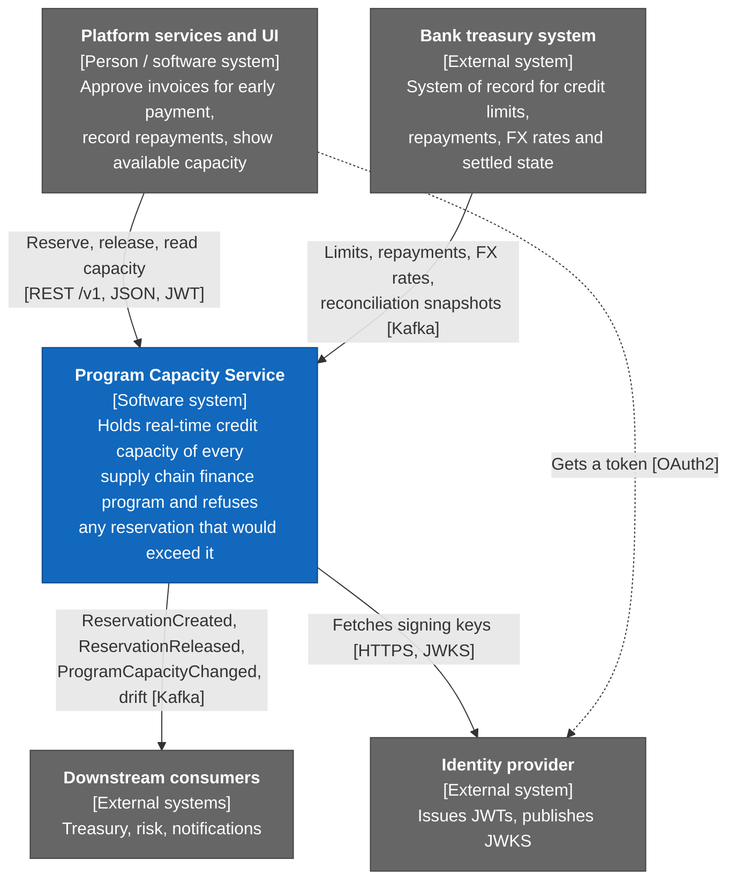

Two facts drive the whole design:

- **Two writers change capacity.** The platform reserves and releases through REST. Treasury
  changes limits, reports repayments and sends full snapshots through Kafka. Both must go
  through the same rules, and the same check must protect the limit.
- **Treasury is the system of record for limits.** The service is the system of record for its
  own reservations until treasury has seen them (PRD assumption A1). Reconciliation settles the
  differences.

## Level 2 — Containers

What runs. One Docker image, started in two **roles** chosen by `APP_ROLE`.

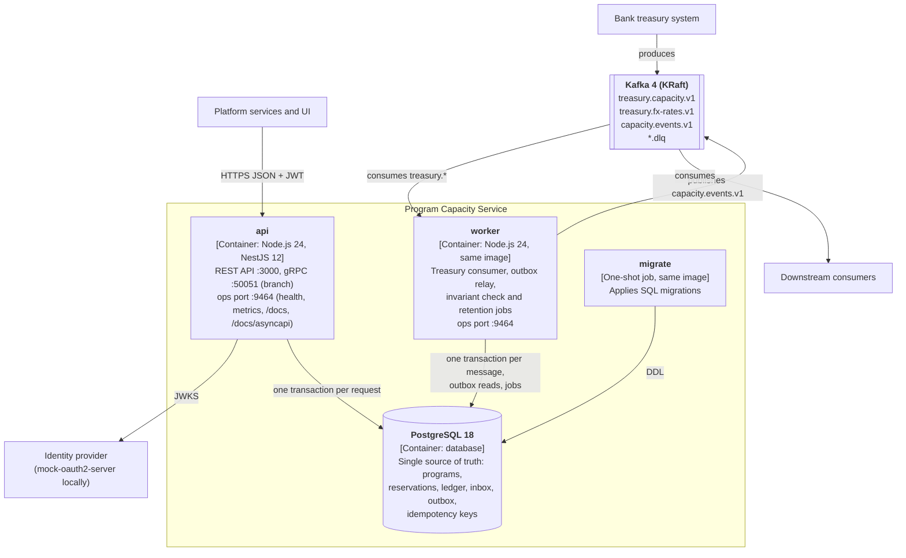

| Container | What it does | Why it exists |
| --- | --- | --- |
| `api` | Validates the JWT, validates input, runs one use case in one database transaction, answers. On the branch it also serves the internal gRPC port (:50051) | Serves the platform. Scales out with no coordination: the database does the locking |
| `worker` | Consumes treasury topics, publishes the outbox, runs scheduled jobs | Keeps Kafka and background work out of the request path. A Kafka outage never slows the API (NFR-06) |
| PostgreSQL | Holds every piece of state, including the inbox, outbox and idempotency keys | One place for the truth means one transaction can protect the limit (ADR 002) |
| Kafka | Treasury input, platform output, dead-letter topics | Asynchronous boundary with the bank and with other services |
| `migrate` | Runs SQL migrations once before `api` and `worker` start | Schema changes never race with traffic; readiness stays red until the schema exists |

Both roles also expose an **ops port** (9464) with `/health/live`, `/health/ready` and
`/metrics`; the `api` role adds the contracts: Swagger UI at `/docs` and the AsyncAPI page of
every Kafka topic at `/docs/asyncapi`. It is internal: an ingress routes only port 3000, and an
orchestrator cannot send a JWT to a health check (PRD assumption A8). Locally, `APP_ROLE=all`
runs both roles in one process (used by some tests).

Optional, with `make up-all` (compose profile `observability`): Prometheus, Grafana, Jaeger and
Kafka UI.

## Level 3 — Components

What is inside the code. The layout is **hexagonal** (ports and adapters) with **vertical
slices**: each use case is a folder with its own code and tests.

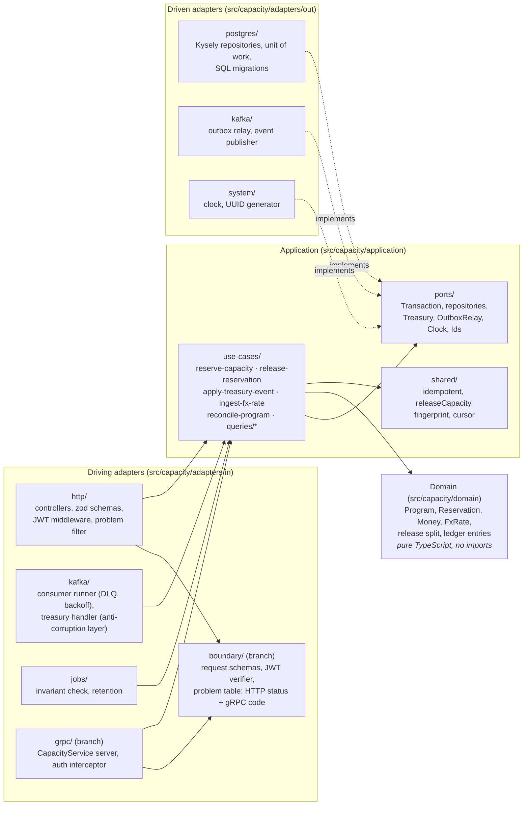

The arrows are enforced, not just drawn. `npm run depcruise` (part of `make verify`) fails the
build when:

- `domain` imports anything outside itself;
- `application` imports an adapter or platform code;
- one adapter imports another;
- one use-case slice imports another.

On the branch the HTTP and gRPC adapters may share one thing, `adapters/in/boundary/`: the
request schemas, money parsing, the JWT verifier and one table that maps every problem type to an
HTTP status and a gRPC code. A new problem type does not compile until it has both mappings
([ADR 024](adr/024-grpc-driving-adapter.md)).

`src/platform/` holds what is not business code: config (validated with zod at start-up),
logging (pino), health and the ops server, telemetry (OpenTelemetry, Prometheus) and the
bootstrap that wires everything per role.

**Why this shape.** The same business rule is reached from three places: the REST release
endpoint, the Kafka `RepaymentReceived` message and reconciliation. Keeping the rule in the
domain and the application layer means it is written once
(`src/capacity/application/shared/release-capacity.ts` is called by both the HTTP and the
Kafka path). Domain and use-case tests run in milliseconds against in-memory ports. Details:
[ADR 018](adr/018-hexagonal-architecture.md).

## The four main flows

### 1. Reserve capacity (REST)

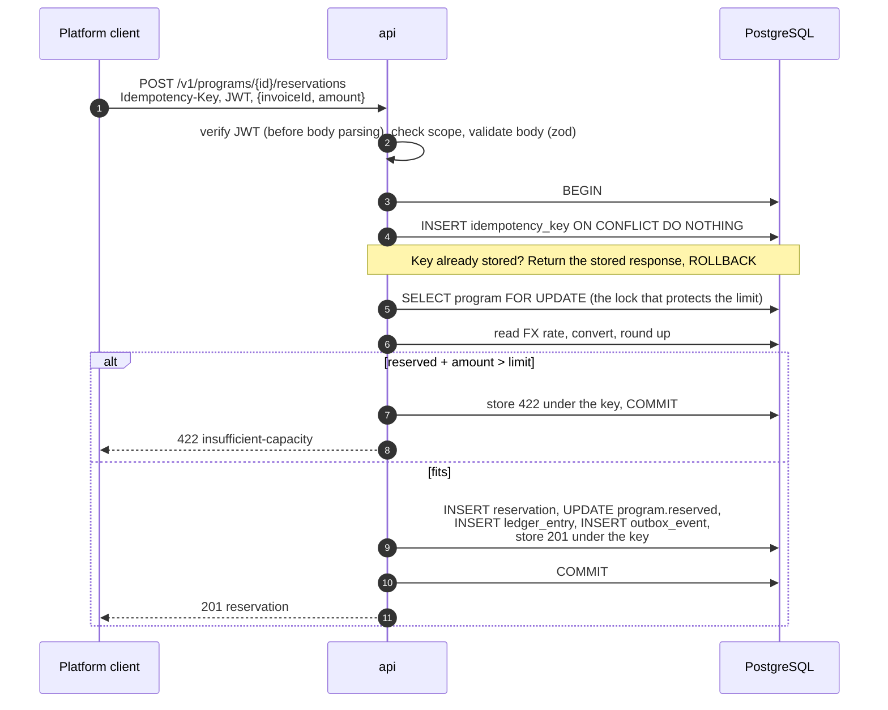

The important part is step 5: all reserves for one program queue on one row lock, so two
concurrent reserves can never both see the same "available" amount. A database `CHECK` and a
trigger-free guard in SQL (`reserved_minor <= credit_limit_minor` for new reservations) back
the application check. [ADR 003](adr/003-concurrency-lock-order.md) explains the lock order
and why it cannot deadlock.

### 2. Repayment from treasury (Kafka)

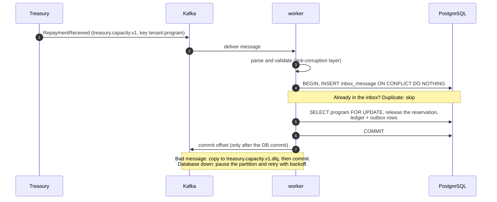

Kafka delivers at least once. The inbox table turns that into exactly-once *effects*: a
redelivered message finds its id already stored and changes nothing. [ADR 007](adr/007-kafka-consumer-semantics.md).

### 3. Publishing events (transactional outbox)

Every change writes an `outbox_event` row **in the same transaction** as the change. The
worker's relay reads unpublished rows in order, sends them to `capacity.events.v1`, waits for
the broker's acknowledgement and marks them published. If the process dies between "send" and
"mark", the event is sent again; consumers drop duplicates by event id.

Only one relay may publish at a time, to keep per-program order. It holds a lease row with a
30-second TTL and an **epoch** number. A relay that was paused and lost its lease cannot mark
anything as published, because its epoch is stale. [ADR 009](adr/009-outbox-relay-lease.md).

### 4. Reconciliation (Kafka snapshot)

Treasury periodically sends `ProgramReconciled`: its full view of one program (the limit and
every open reservation). The worker compares it with its own state and applies a case table:
treasury wins on limits and on amounts beyond a small tolerance; reservations treasury has not
seen yet (newer than its watermark) are kept; reservations treasury should know but does not
are put on HOLD and reported as drift, not silently released. The comparison is set-based SQL
over a staging table, so a large snapshot does not hold the program lock for long.
[ADR 008](adr/008-reconciliation.md), and the worked example in
[how-it-works.md](how-it-works.md#reconciliation).

## Data model

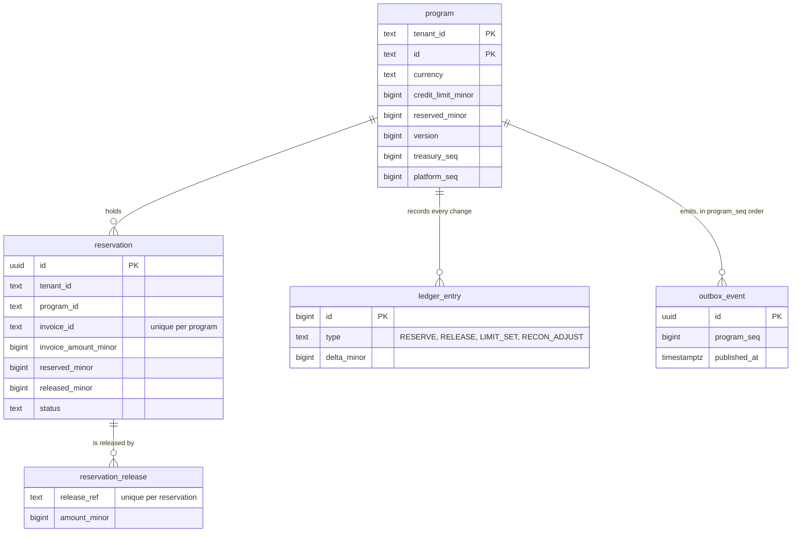

Supporting tables: `fx_rate` (latest treasury rates), `idempotency_key` (stored responses,
24 h), `inbox_message` (processed Kafka message ids), `outbox_relay_lease` (one row),
`reconcile_snapshot_row` (staging for snapshots), `schema_migrations`.

Money is always `bigint` **minor units** (cents, fils) plus an ISO 4217 code, never a
JavaScript `number`. `program.reserved_minor` is a projection of the open reservations, and the
invariant job recomputes it every 5 minutes to prove it (FR-15).

## Branch `microservices`: funding, the payment rail and the gRPC hop

The capacity service above is unchanged on the branch: its reservation transaction, its
invariants and its REST API stay as they are. What the branch adds is a second bounded context
and the plumbing between them. Why now: [ADR 023](adr/023-funding-context-database-per-service.md)
(the trigger "a new bounded context" fired), [ADR 024](adr/024-grpc-driving-adapter.md) (gRPC),
[ADR 025](adr/025-funding-saga-orchestration.md) (the saga).

### Context

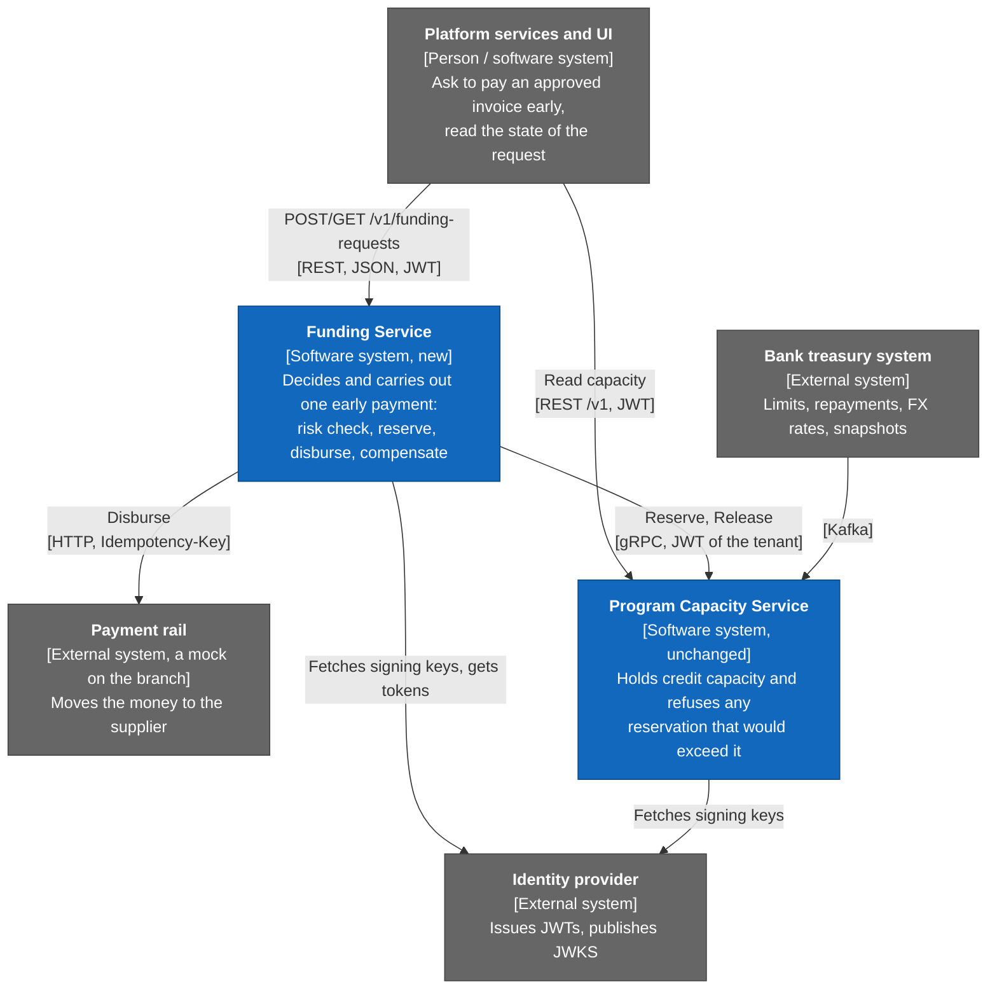

A funding request needs two systems that share no transaction: capacity (it must hold the
credit before money moves) and the payment rail (it takes part in none of our transactions).
So the flow cannot be one database transaction; it is a saga, a sequence of steps with a
compensation.

### Containers

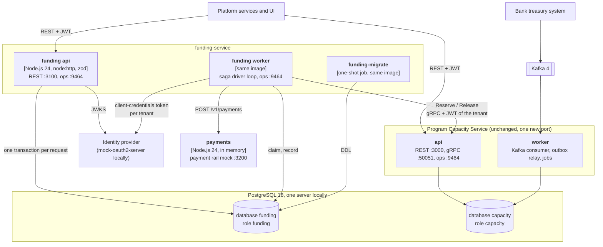

| Container | What it does | Why it exists |
| --- | --- | --- |
| `funding-api` | Verifies the JWT (audience `funding-service`), validates the body, and in one transaction stores the idempotency key, the request in state `RECEIVED` and an outbox row. Answers `202` with `Location` | Takes requests without waiting for money to move. It never calls capacity or the rail |
| `funding-worker` | The saga driver: claims due requests, calls capacity or the rail outside any transaction, records the result | The only place that calls the other systems. Several workers can run; the claim and the version check keep them apart |
| `funding-migrate` | Applies the funding SQL migrations once before the others start | Same reason as capacity's `migrate` |
| `payments` | The mock payment rail: idempotency keys, a lookup by key, fault markers in the invoice id (`FAULT-DECLINE`, `FAULT-TIMEOUT`, `FAULT-5XX-<n>`). In memory, no database, no authentication | Stands in for an external system with an uncertain outcome, so the saga's hard paths can be tested and demonstrated |
| capacity `api`, gRPC port | `CapacityService` (`Reserve`, `Release`, `GetAvailability`) over the same use cases as REST | A synchronous, typed call that funding needs before it pays. Internal only: published on the host on `127.0.0.1` in compose, never routed by the gateway |

Both databases live on one PostgreSQL server locally. They are separate databases with separate
login roles and no grants across, and a test proves each role is refused by the other's database
(`services/funding/test/integration/database.int.test.ts`, acceptance criterion FS-14 of
[the funding-saga spec](../specs/0006-funding-saga/spec.md)). In production they would be
separate instances. Data crosses the boundary only through the gRPC contract
(`packages/contracts/proto/`).

In the kind cluster an Envoy Gateway sits in front of both REST APIs (JWT checked at the edge,
CORS, a per-tenant rate limit) and the services still verify the token themselves; the gRPC
port is not routed ([ADR 029](adr/029-api-gateway.md), [ADR 026](adr/026-helm-and-kind.md)).
Compose has no gateway.

Facts about the kind deployment that are easy to get wrong (all seen in the live run):

- **Where things live.** The workloads, the mock OAuth2 server and the `gateway` policies are in
  namespace `finverity-ms`. Envoy Gateway runs in `envoy-gateway-system`, and so does the proxy
  Service `gateway-edge` it creates for the `Gateway`; a Pod addresses it as
  `gateway-edge.envoy-gateway-system.svc.cluster.local`.
- **One issuer.** Capacity, funding and the gateway all use the in-cluster address of the mock
  OAuth2 Service as the issuer (`KIND_OAUTH_ISSUER` in the Makefile), and funding mints its tokens
  for capacity at the same address; a token minted at the short Service name carries a foreign `iss`.
- **Order of readiness.** `make kind-up` waits for the `Gateway` to be `Programmed` and for the
  proxy Deployment to be available before it returns, because the Helm release wait does not cover
  the proxy Pod that Envoy Gateway creates afterwards.
- **A changed token mapping needs a new OAuth2 Pod.** The mock reads its config at start, so the
  `local-infra` chart puts a checksum of the config on the Pod template and Helm restarts it.
- **Two refusals for a bad token.** The edge answers `401` for a missing, malformed, expired or
  foreign-issuer token and `403` for a token of another audience; both bodies are Envoy's, not
  `application/problem+json`. The services answer their own `401` problem
  ([docs/api.md](api.md#through-the-gateway-kind-only)).

### Components of funding-service

The same hexagonal rules as capacity, applied to `services/funding/src/funding/` and enforced by
dependency-cruiser:

- `domain/`: pure TypeScript. The funding request, the saga transition table, the outcome
  classes (definite success, definite failure, unknown), the deterministic step keys, minor-unit
  money, the risk policy, the deadlines and their boot-time validation.
- `application/`: the two REST use cases (`CreateFundingRequest`, `GetFundingRequest`), the
  `SagaDriver` loop body, and the ports (`SagaStore`, `CapacityGateway`, `PaymentRail`).
- `adapters/in/http/`: a plain `node:http` server, the JWT verifier, zod schemas, RFC 9457
  problems. It is not NestJS.
- `adapters/out/`: PostgreSQL (Kysely: unit of work, saga store), the gRPC client of capacity
  with a token cache per tenant, the HTTP client of the rail, the OAuth2 token provider.
- `src/ops/`: the ops server (`/health/live`, `/health/ready`, `/metrics`) used by both roles.

### Flow 5: a funding request (the saga)

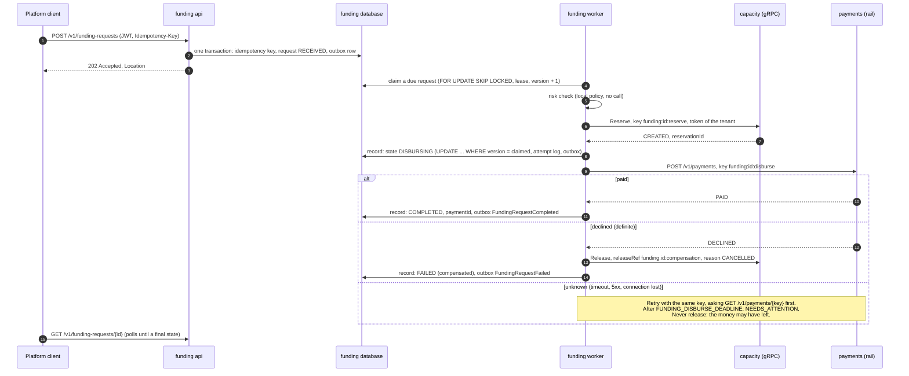

The states and the moves between them:

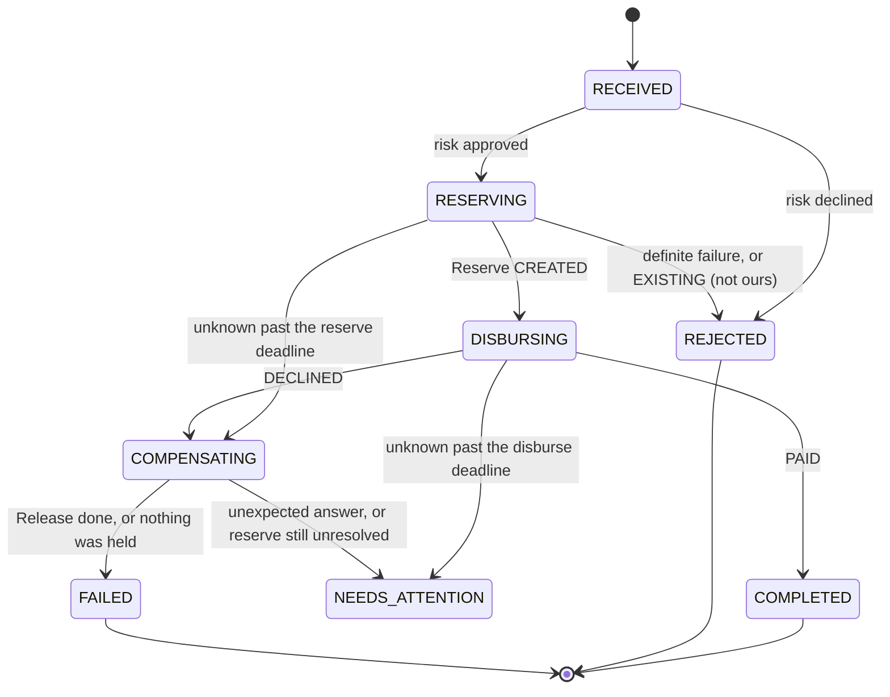

`NEEDS_ATTENTION` is left only by an operator. Until the operator command exists (task T22) the
[runbook](runbook.md#funding-a-request-needs-attention-fundingneedsattention) closes such a
request with SQL.

Four rules carry the design. Each has a test, listed in
[ADR 025](adr/025-funding-saga-orchestration.md):

1. **One key per step, derived, never generated.** `funding:<id>:reserve`, `:disburse` and
   `:release` (and the permanent `releaseRef` `funding:<id>:compensation`). A retry is the same
   request to the receiver, so delivery is at least once and the effect is exactly once: the
   receiver deduplicates in the same transaction as its effect.
2. **No transaction spans a network call.** Claim (short transaction), call, record (short
   transaction). If the lease expires during a call, a second worker may take the step over; the
   late result of the first updates no row because of the version check.
3. **An unknown payment is never compensated.** Releasing capacity while the money may have left
   would leave the funder exposed with no capacity held. The request waits, then parks with
   the capacity still held and an alert raised.
4. **The reserve retry window is bounded by capacity's key memory.** Capacity remembers an
   `Idempotency-Key` for 24 hours. Past that, a repeat would meet the natural key and be read as
   "someone else's reservation". Funding therefore refuses to start with retry settings that
   reach the window ([runbook](runbook.md#funding-the-reserve-retry-window-branch-microservices)).

### Funding data model

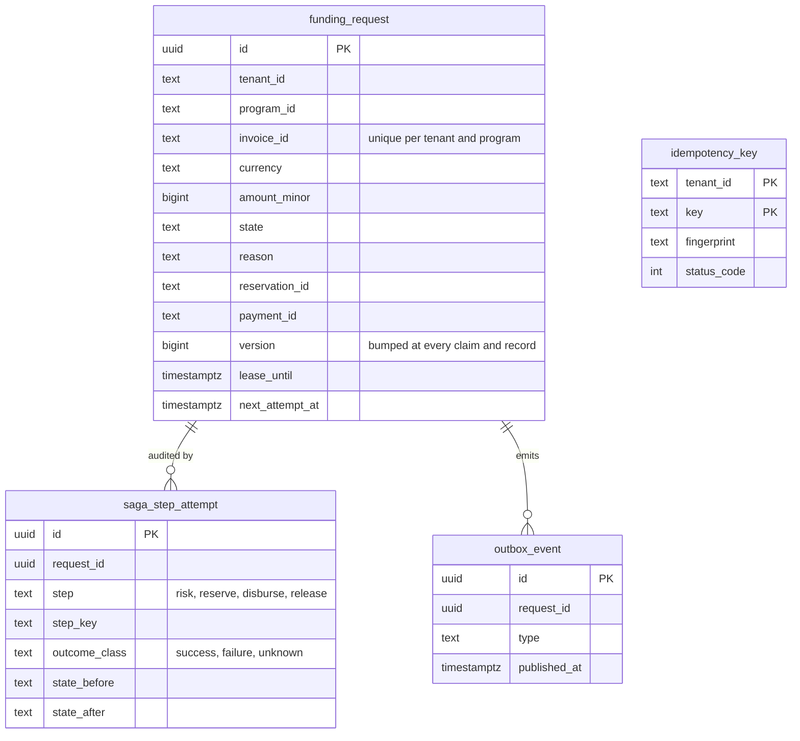

`saga_step_attempt` is append-only (a trigger refuses update, delete and truncate).
`CHECK` constraints back the states: a request that is paying out has a reservation, a completed
one has a payment, and a step with a business deadline always has one. The outbox rows are
written with each state change; the relay that would publish them to Kafka (`funding.events.v1`)
is not built yet, so today they are the seam, as capacity's outbox was before its relay.

### What differs from capacity, and why

| | Capacity | Funding |
| --- | --- | --- |
| Question | Is there room under the limit? | Do we pay, and did the money go out? |
| Consistency | One PostgreSQL transaction on one row | A saga across two services and an external rail |
| Hot spot | One program row, a lock | None: requests are independent rows, claimed with `SKIP LOCKED` |
| Unknown outcome | Does not arise: one database | The central case: classified, retried with the same key, parked after a deadline |
| Inbound transport | REST, gRPC, Kafka | REST |
| Framework | NestJS 12 | Plain `node:http` and zod |
| Tracing | OpenTelemetry (`OTEL_ENABLED`) | Not instrumented: JSON logs, Prometheus metrics and alerts only |

## Where to read more

| Topic | Document |
| --- | --- |
| Why each decision was made | [adr/](adr/) — 29 short records (001 to 022 on `main`, 023 to 029 on the branch), index in [README](README.md#decision-records) |
| How the branch maps to the job description and the assignment | [position-fit.md](position-fit.md) |
| Assumptions and trade-offs | [assumptions-and-trade-offs.md](assumptions-and-trade-offs.md) |
| Infrastructure we chose not to add (PgBouncer, Debezium, Floci, gRPC, Redis) | [infrastructure-choices.md](infrastructure-choices.md) |
| Full requirements | [PRD.md](PRD.md) |
| Operating the service | [runbook.md](runbook.md) |
