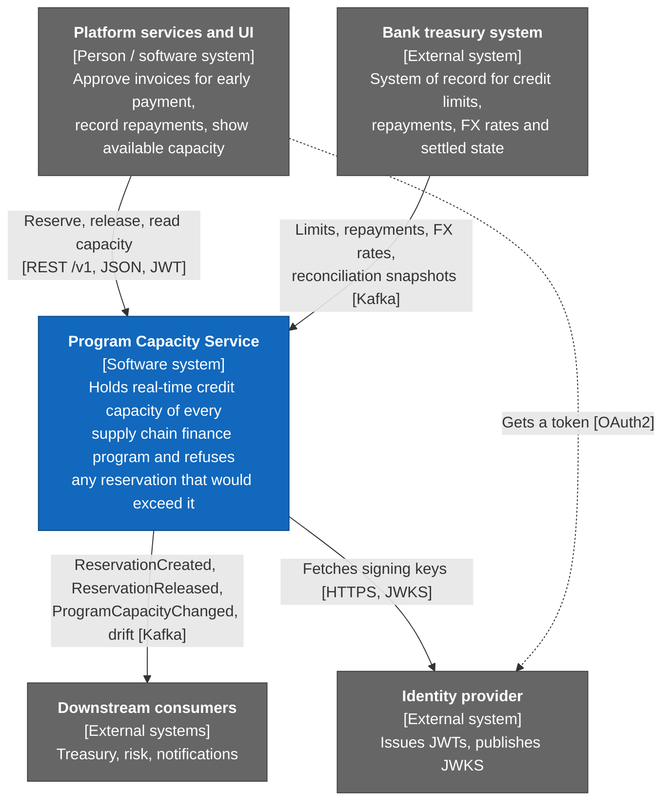
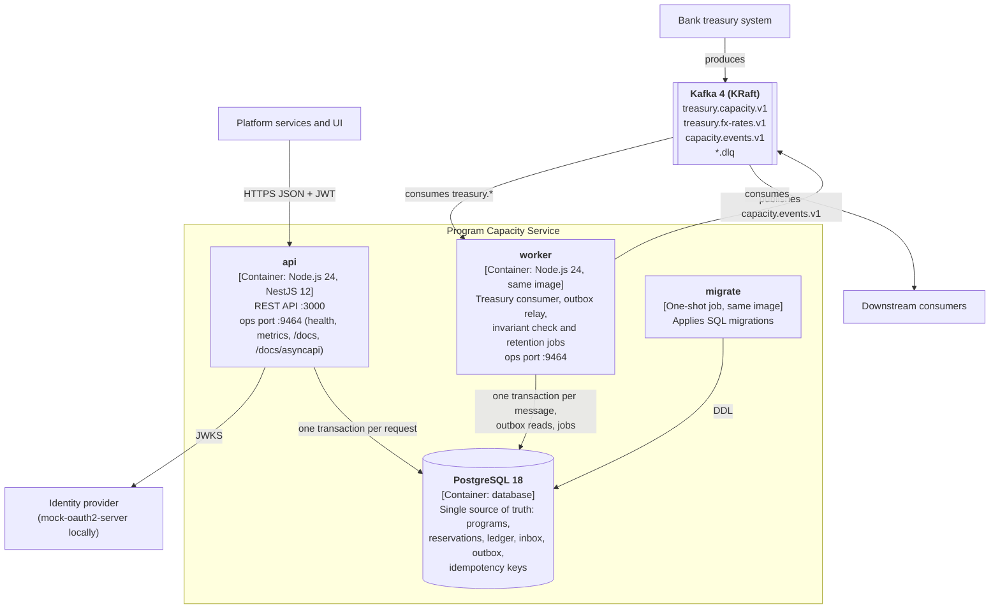
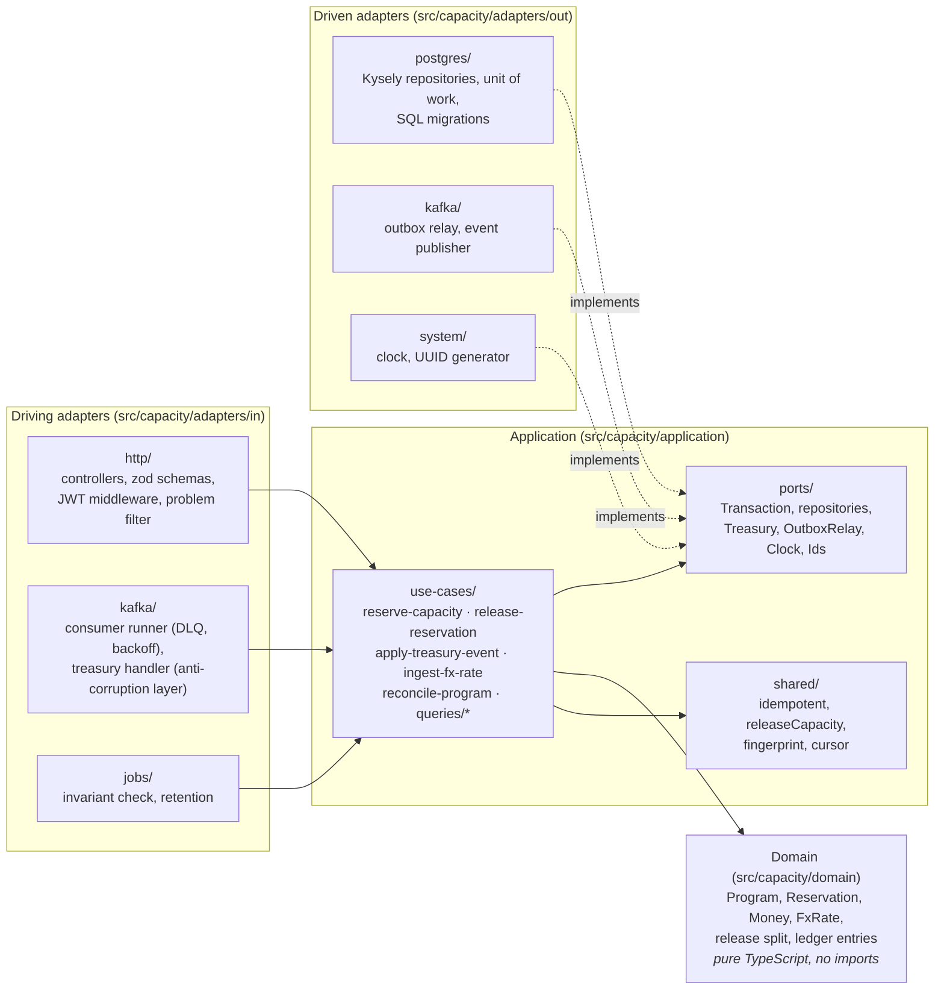
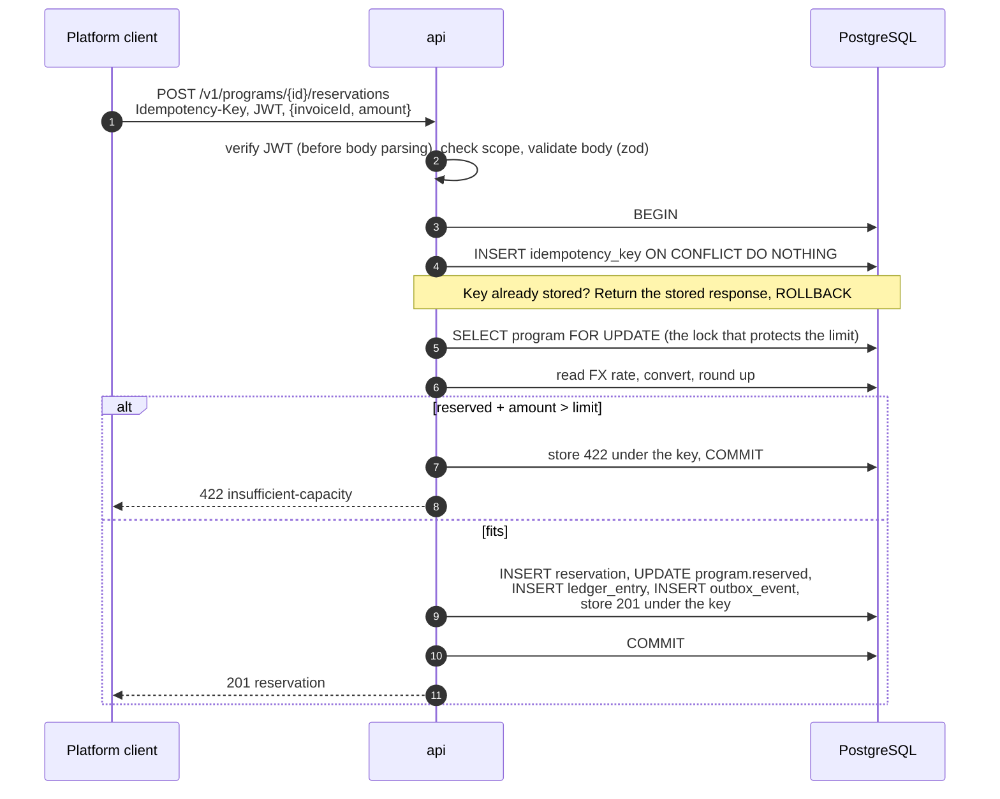
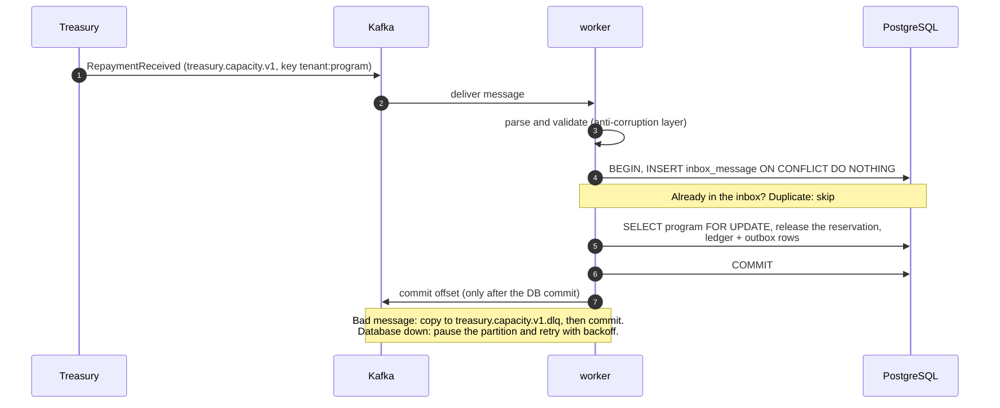
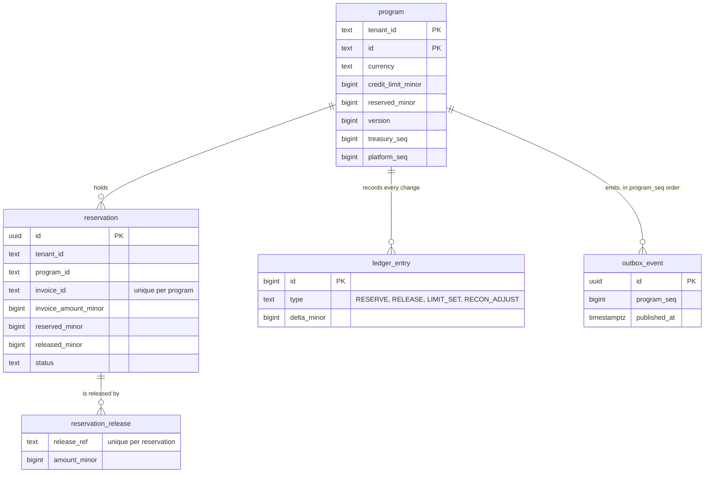

# Architecture

This page explains how the service is built, from the outside in, using the
[C4 model](https://c4model.com): **context** (who talks to the service), **containers** (what
runs), **components** (what is inside the code). Then it walks through the four main flows
and the data model. The diagrams are Mermaid, so GitHub renders them.

If you have not read [how-it-works.md](how-it-works.md) yet, read it first: it explains the
business words (program, reservation, release, snapshot) that this page uses.

## Level 1 — System context

Who uses the service and which systems it talks to.

Two facts drive the whole design:

- **Two writers change capacity.** The platform reserves and releases through REST. Treasury
  changes limits, reports repayments and sends full snapshots through Kafka. Both must go
  through the same rules, and the same check must protect the limit.
- **Treasury is the system of record for limits.** The service is the system of record for its
  own reservations until treasury has seen them (PRD assumption A1). Reconciliation settles the
  differences.

## Level 2 — Containers

What runs. One Docker image, started in two **roles** chosen by `APP_ROLE`.

| Container | What it does | Why it exists |
| --- | --- | --- |
| `api` | Validates the JWT, validates input, runs one use case in one database transaction, answers | Serves the platform. Scales out with no coordination: the database does the locking |
| `worker` | Consumes treasury topics, publishes the outbox, runs scheduled jobs | Keeps Kafka and background work out of the request path. A Kafka outage never slows the API (NFR-06) |
| PostgreSQL | Holds every piece of state, including the inbox, outbox and idempotency keys | One place for the truth means one transaction can protect the limit (ADR 002) |
| Kafka | Treasury input, platform output, dead-letter topics | Asynchronous boundary with the bank and with other services |
| `migrate` | Runs SQL migrations once before `api` and `worker` start | Schema changes never race with traffic; readiness stays red until the schema exists |

Both roles also expose an **ops port** (9464) with `/health/live`, `/health/ready` and
`/metrics`; the `api` role adds the contracts: Swagger UI at `/docs` and the AsyncAPI page of
every Kafka topic at `/docs/asyncapi`. It is internal: an ingress routes only port 3000, and an
orchestrator cannot send a JWT to a health check (PRD assumption A8). Locally, `APP_ROLE=all`
runs both roles in one process (used by some tests).

Optional, with `docker compose --profile observability`: Prometheus, Grafana and Jaeger.

## Level 3 — Components

What is inside the code. The layout is **hexagonal** (ports and adapters) with **vertical
slices**: each use case is a folder with its own code and tests.

The arrows are enforced, not just drawn. `npm run depcruise` (part of `make verify`) fails the
build when:

- `domain` imports anything outside itself;
- `application` imports an adapter or platform code;
- one adapter imports another;
- one use-case slice imports another.

`src/platform/` holds what is not business code: config (validated with zod at start-up),
logging (pino), health and the ops server, telemetry (OpenTelemetry, Prometheus) and the
bootstrap that wires everything per role.

**Why this shape.** The same business rule is reached from three places: the REST release
endpoint, the Kafka `RepaymentReceived` message and reconciliation. Keeping the rule in the
domain and the application layer means it is written once
(`src/capacity/application/shared/release-capacity.ts` is called by both the HTTP and the
Kafka path). Domain and use-case tests run in milliseconds against in-memory ports. Details:
[ADR 018](adr/018-hexagonal-architecture.md).

## The four main flows

### 1. Reserve capacity (REST)

The important part is step 5: all reserves for one program queue on one row lock, so two
concurrent reserves can never both see the same "available" amount. A database `CHECK` and a
trigger-free guard in SQL (`reserved_minor <= credit_limit_minor` for new reservations) back
the application check. [ADR 003](adr/003-concurrency-lock-order.md) explains the lock order
and why it cannot deadlock.

### 2. Repayment from treasury (Kafka)

Kafka delivers at least once. The inbox table turns that into exactly-once *effects*: a
redelivered message finds its id already stored and changes nothing. [ADR 007](adr/007-kafka-consumer-semantics.md).

### 3. Publishing events (transactional outbox)

Every change writes an `outbox_event` row **in the same transaction** as the change. The
worker's relay reads unpublished rows in order, sends them to `capacity.events.v1`, waits for
the broker's acknowledgement and marks them published. If the process dies between "send" and
"mark", the event is sent again; consumers drop duplicates by event id.

Only one relay may publish at a time, to keep per-program order. It holds a lease row with a
30-second TTL and an **epoch** number. A relay that was paused and lost its lease cannot mark
anything as published, because its epoch is stale. [ADR 009](adr/009-outbox-relay-lease.md).

### 4. Reconciliation (Kafka snapshot)

Treasury periodically sends `ProgramReconciled`: its full view of one program (the limit and
every open reservation). The worker compares it with its own state and applies a case table:
treasury wins on limits and on amounts beyond a small tolerance; reservations treasury has not
seen yet (newer than its watermark) are kept; reservations treasury should know but does not
are put on HOLD and reported as drift, not silently released. The comparison is set-based SQL
over a staging table, so a large snapshot does not hold the program lock for long.
[ADR 008](adr/008-reconciliation.md), and the worked example in
[how-it-works.md](how-it-works.md#reconciliation).

## Data model

Supporting tables: `fx_rate` (latest treasury rates), `idempotency_key` (stored responses,
24 h), `inbox_message` (processed Kafka message ids), `outbox_relay_lease` (one row),
`reconcile_snapshot_row` (staging for snapshots), `schema_migrations`.

Money is always `bigint` **minor units** (cents, fils) plus an ISO 4217 code, never a
JavaScript `number`. `program.reserved_minor` is a projection of the open reservations, and the
invariant job recomputes it every 5 minutes to prove it (FR-15).

## Where to read more

| Topic | Document |
| --- | --- |
| Why each decision was made | [adr/](adr/) — 22 short records, index in [README](README.md#decision-records) |
| Assumptions and trade-offs | [assumptions-and-trade-offs.md](assumptions-and-trade-offs.md) |
| Infrastructure we chose not to add (PgBouncer, Debezium, Floci, gRPC, Redis) | [infrastructure-choices.md](infrastructure-choices.md) |
| Full requirements | [PRD.md](PRD.md) |
| Operating the service | [runbook.md](runbook.md) |
