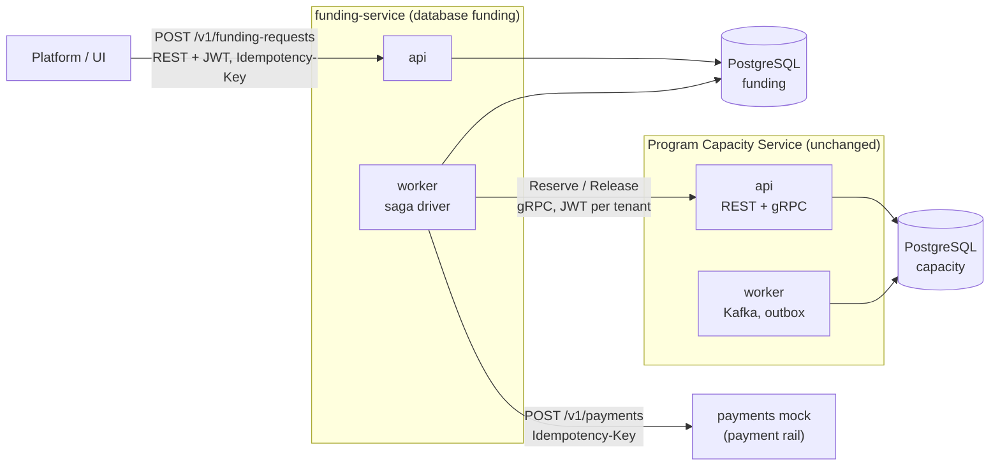
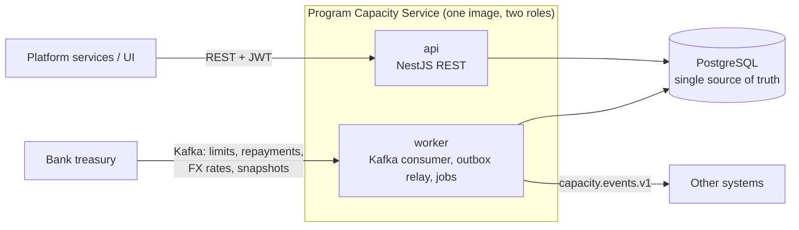

# Branch `microservices`: technical overview

The README says why the branch exists. This page is the technical summary that used to sit in
it: what each new part is, how to run and demo it, the cluster and CI, and the capacity service
as submitted on `main`. Ports, profiles and every container are in
[local-stack.md](local-stack.md); the C4 diagrams and the saga step by step are in
[architecture.md](architecture.md#branch-microservices-funding-the-payment-rail-and-the-grpc-hop).

## What the branch adds

Capacity is unchanged. Next to it runs a second service that decides whether to pay a supplier
early and has to touch two systems that share no transaction: capacity and a payment rail.



- **`funding-service`** (`services/funding/`): `POST` and `GET /v1/funding-requests`, JWT with
  audience `funding-service`, `Idempotency-Key`, RFC 9457 problems, OpenAPI generated from zod.
  It owns its own PostgreSQL database and role ([ADR 023](adr/023-funding-context-database-per-service.md)).
- **A saga** in the funding worker ([ADR 025](adr/025-funding-saga-orchestration.md)): risk
  check, then `Reserve` on capacity over gRPC, then `Disburse` on the rail, and on a definite
  payment failure a compensating `Release`. State is in PostgreSQL; every step has a
  deterministic idempotency key (`funding:<id>:reserve`, `:disburse`, `:release`), so a retry is
  the same request to the receiver. An unknown outcome of the payment is never compensated: the
  request is parked as `NEEDS_ATTENTION` with the capacity still held, and an alert fires.
- **Internal gRPC on capacity** ([ADR 024](adr/024-grpc-driving-adapter.md)): the same use
  cases as REST behind one boundary module; the same acceptance cases pass over both transports.
- **`payments-mock`** (`services/payments-mock/`): an in-memory payment rail with idempotency
  keys and fault markers in the invoice id (`FAULT-DECLINE`, `FAULT-TIMEOUT`, `FAULT-5XX-<n>`).
- **Helm, kind and an Envoy gateway** ([ADR 026](adr/026-helm-and-kind.md),
  [ADR 029](adr/029-api-gateway.md)): `make kind-up` builds three images and installs five
  Helm releases (local infrastructure, capacity, funding, Envoy Gateway, the gateway policies)
  into a local cluster.
- **Operations**: funding ops ports with `/health/live`, `/health/ready` and `/metrics`, three
  Prometheus alerts (`FundingNeedsAttention`, `FundingCompensationStuck`,
  `FundingReserveUnresolved`) and a runbook entry for each ([runbook.md](runbook.md)).
- **Layout** ([ADR 027](adr/027-repository-layout-and-side-by-side-isolation.md)): npm
  workspaces, capacity stays at the repository root; the contracts package
  `packages/contracts` ([ADR 028](adr/028-contracts-package-and-consumer-contracts.md)).

The funding service and the payments mock use plain `node:http` and zod, not NestJS.

## Status by task

The minimum viable cut of the funding-saga work plan (`specs/0006-funding-saga/`, tasks T1 to
T24) is built: side-by-side isolation, npm workspaces, the internal gRPC adapter (T1 to T6); `funding-service` with its saga, ops ports, metrics, alerts,
the runbook entries and `make demo-funding` (T7 to T14); Helm, kind and the Envoy gateway (T15 to
T16a); the docs (T17); the contracts package (T18); the kind job in CI (T23). Open: Pact tests
(T19, T20), the funding event relay (T21), the operator command for a request that needs
attention (T22) and funding consuming capacity events (T24). The list is in
[specs/0006-funding-saga/tasks.md](../specs/0006-funding-saga/tasks.md).

## Run it and the funding demo

Requirements and the capacity quick start are in [local-stack.md](local-stack.md#quick-start).

```bash
make down              # once, if you ran an older version of this branch: the database volume
                       # from before the funding database existed is deleted
make up                # PostgreSQL, Kafka, OAuth2, capacity api and worker, payments mock,
                       # funding migrate, api and worker; returns when all are healthy
make seed              # banks, programs, FX rates (valid 24 h: run again on the day of a demo)
make demo-funding      # six funding scenarios against the live stack
```

`make demo-funding` restarts the funding worker with a 15 second disbursement deadline (the
default is 15 minutes) so the needs-attention path does not take 15 minutes, runs the
scenarios (each may take up to two minutes), prints capacity's `reserved` before and after each
one, and restores the worker. It exits with 1 if any scenario does not end as expected.

| Scenario | How it is triggered | Expected end state | Capacity |
| --- | --- | --- | --- |
| `completed` | a normal invoice | `COMPLETED` | amount held |
| `risk-declined` | amount above the risk limit | `REJECTED` (`risk-declined`) | untouched, never called |
| `insufficient-capacity` | amount above what is available | `REJECTED` (`insufficient-capacity`) | untouched |
| `payment-declined` | invoice id `FAULT-DECLINE…` | `FAILED`, compensated | reserved, then released |
| `rail-unavailable` | invoice id `FAULT-5XX-999…` | `NEEDS_ATTENTION` (`disbursement-unknown`) | held, never released |
| `lost-payment-answer` | invoice id `FAULT-TIMEOUT…` | `COMPLETED` | held; the payment is found again by its key |

By hand, after `make up` and `make seed`:

```bash
FTOKEN=$(make -s token TENANT=bank-a SCOPES="funding:write funding:read")
curl -si -X POST localhost:13100/v1/funding-requests \
  -H "authorization: Bearer $FTOKEN" -H "content-type: application/json" \
  -H "idempotency-key: $(uuidgen)" \
  -d '{"programId":"prg_grand_usd","invoiceId":"INV-FUND-1","amount":{"value":"1000.00","currency":"USD"}}'
# 202 Accepted, Location: /v1/funding-requests/<id>; poll that URL until "state" is COMPLETED
```

The funding API, its errors and the gRPC contract: [api.md](api.md#funding-api-branch-microservices).

## On a cluster

Needs `kind`, `helm` and `kubectl`. Details, ports and a failure checklist:
[local-stack.md](local-stack.md#kubernetes-branch-microservices) and
[runbook.md](runbook.md#kind-cluster-branch-microservices).

```bash
make helm-check        # lint, template and validate every chart (no cluster needed)
make kind-up           # cluster finverity-ms, three images, five Helm releases incl. the gateway
make kind-smoke        # in-cluster tests: capacity, funding saga, gateway
make kind-forward      # port-forwards on 23000-23099 for manual calls
make kind-down         # deletes cluster finverity-ms and nothing else
```

## Kubernetes in CI

`.github/workflows/ci.yml` has a `charts` job (`make helm-check`), builds the funding and
payments-mock images in the `image` job, and a `kind` job that installs kind and runs
`make kind-up` and `make kind-smoke`, the same targets as above, for pushes to `microservices`
and pull requests into it (30 minutes at most; kubectl state is uploaded as an artifact when it
fails). The static test `test/architecture/ci.test.ts` (task T23) pins those targets and conditions.
<!-- proof: test/architecture/ci.test.ts#T23 kind job runs exactly make ki -->
All of them are green on GitHub since the first push of the branch (2026-10-31, run
41170207130: `kind-up` and `kind-smoke` on a fresh runner, saga and gateway smoke included).
What the cluster run covers and what it does not:
the lane handoff, `specs/0006-funding-saga/handoff.md`.

## Not built on this branch

Redis, GraphQL, CQRS, event sourcing, Temporal, a gateway in Compose, a service mesh, a real
cloud, TLS or mTLS between services, Pact tests and the funding event relay (planned, see the
status above).

## The capacity service, as submitted on `main`

The rest of this page describes the capacity service. The branch does not change it.

### The problem in one minute

A bank opens a **program** for a buyer with a **credit limit**, say USD 10,000,000. Each
supplier invoice the bank pays early **reserves** part of that limit; when the buyer repays,
the amount is **released**. Limits, repayments, FX rates and periodic full **snapshots** also
arrive from the bank's **treasury** system over Kafka. Programs and invoices can be in
different currencies.

The service must always answer "how much is available?" correctly, never let two
simultaneous requests both take the last dollar, survive retries and duplicate messages, and
keep every bank's data separate. A worked example is in [how-it-works.md](how-it-works.md).

### What the assignment asked, and where it is

| Asked | Where |
| --- | --- |
| Accept reservations | `POST /v1/programs/{id}/reservations`: one PostgreSQL transaction with a row lock on the program, so the limit holds under any concurrency <!-- proof: test/integration/reserve-concurrency.int.test.ts#AC-01 --> |
| Process releases | `POST …/reservations/{id}/releases` (partial or full) and `RepaymentReceived` from Kafka, sharing one code path |
| Expose current availability | `GET /v1/programs/{id}/capacity`, plus reservation lists and the program ledger |
| Capacity data from treasury via Kafka, incl. bulk reconciliation | Worker consumes `treasury.capacity.v1` and `treasury.fx-rates.v1`; snapshots are reconciled with a documented case table <!-- proof: test/integration/reconcile.int.test.ts#AC-08 --> |
| Different currencies | Treasury FX rates, fixed per reservation, exact integer maths, rounding rules per currency (USD 2 decimals, KWD 3) |
| All endpoints authenticated | JWT (OAuth2 client credentials, JWKS), scopes, tenant isolation <!-- proof: test/e2e/auth.e2e.test.ts#AC-13 --> |
| Runnable locally | `make up`: Docker Compose with PostgreSQL, Kafka, an OAuth2 server, the API and the worker <!-- proof: Makefile --> |
| Production code | Idempotency keys, inbox/outbox, dead-letter topics, graceful shutdown, health checks, metrics, traces; 195 tests on `main`, 100 of them against real PostgreSQL and Kafka |
| Assumptions and trade-offs documented | [assumptions-and-trade-offs.md](assumptions-and-trade-offs.md) |

The same assignment point by point, with what is not covered: [position-fit.md](position-fit.md).

### How it is built



- **One service, two roles.** The same Docker image runs as `api` (HTTP) or `worker` (Kafka and
  background jobs). Splitting capacity into microservices would break the single transaction
  that protects the limit ([ADR 001](adr/001-modular-monolith-roles.md)).
- **The limit is protected by the database.** Each reserve locks the program row
  (`SELECT … FOR UPDATE`), checks, writes and commits. Two requests can never both see the same
  "available" amount ([ADR 003](adr/003-concurrency-lock-order.md)).
- **Retries and duplicates are harmless.** REST writes accept an `Idempotency-Key`; Kafka
  messages are recorded in an inbox table in the same transaction as their effect.
- **Events are never lost or invented.** Changes write an outbox row in the same transaction;
  the worker publishes it afterwards ([ADR 009](adr/009-outbox-relay-lease.md)).
- **Business rules live in one place.** Hexagonal layout: pure domain code, use cases, and
  adapters for HTTP, Kafka and PostgreSQL. A build check forbids the layers from leaking
  ([ADR 018](adr/018-hexagonal-architecture.md)).

On the branch, capacity is one of three deployables; the other two are in
[What the branch adds](#what-the-branch-adds).

### Assumptions and trade-offs (short)

The full list with reasons is in [assumptions-and-trade-offs.md](assumptions-and-trade-offs.md). The main ones:

- **Treasury owns credit limits.** There is no REST endpoint to set a limit; limits arrive
  over Kafka.
- **A limit cut never cancels existing reservations**; the program goes "over limit" and
  refuses new reservations.
- **FX rates come from treasury**, are valid for 24 hours, are fixed at reservation time, and
  conversion rounds up.
- **When treasury's snapshot is missing a reservation it should know, the service holds it
  and raises an alert** rather than releasing capacity on a guess (configurable).
- **Health and metrics are not behind a JWT.** They are on a separate internal port, because
  orchestrators and Prometheus cannot send tokens. Every business endpoint is authenticated.
- **Deliberately not used (on `main`):** gRPC ([why](adr/022-no-grpc-adapter.md)), Redis,
  PgBouncer, Debezium, AWS emulators ([why each](infrastructure-choices.md)), event
  sourcing, sagas, GraphQL ([ADR 017](adr/017-out-of-scope.md)). On branch `microservices`
  gRPC and a saga are built (ADR 024, ADR 025); Redis, event sourcing and GraphQL still are not.

Running in production (not built): [infrastructure-choices.md](infrastructure-choices.md#running-in-production-not-built-here).
Checks and the load test: [testing.md](testing.md). Every path: [repository-map.md](repository-map.md).
