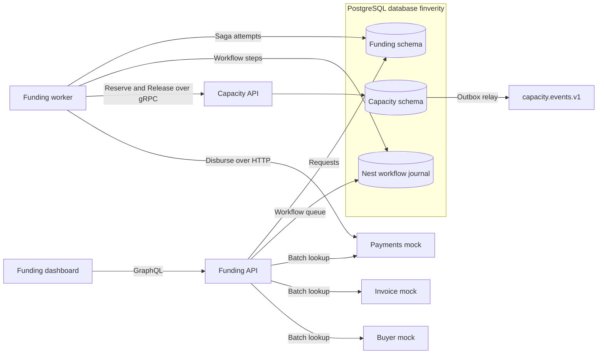

# Funding microservices POC

A supplier can request early payment for an invoice. Funding checks the request, asks Capacity to reserve part of the buyer's credit limit, then sends the payment to a simulated rail. If the rail definitively declines, Funding asks Capacity to release the reservation. If the outcome is unknown, Funding keeps the reservation while it retries or waits for an operator.

## Run the demo

Use Docker Compose, Node.js 24, and npm. Run these commands from the `microservices` checkout.

```bash
npm ci
make up
make seed
```

Open the [funding dashboard](http://localhost:13300/). It obtains a local `bank-a` token on the Compose stack. Choose **Успешная выплата** and click **Запустить сценарий**. The dashboard shows **Выплачено** (`COMPLETED`). Run **Отказ платёжной системы** next. The dashboard shows **Не выплачено** (`FAILED`) and marks compensation complete after releasing the reservation. Use the request history to inspect both results and the GraphQL batch counts.

## How the services fit together



Compose runs one PostgreSQL database, `finverity`. The `capacity` role owns the `capacity` schema and the `funding` role owns the `funding` schema. The Funding API creates a request and enqueues `funding-saga` in one transaction. The Funding worker runs it with `@nestjs/workflows`, which stores execution history in its internal `nest_workflows` schema under the Funding role. Funding owns the business transitions, deterministic step keys and retry policy. `funding.funding_request` holds the current state and `funding.saga_step_attempt` records each attempt. Capacity reserves and releases in its own transactions. Its outbox relay publishes `ReservationCreated` and `ReservationReleased` to Kafka.

Funding also writes terminal events to its own outbox. The Capacity topic carries the reservation events for this demo. The three external HTTP services are mocks, and the Payments mock keeps its state in memory. The dashboard uses local demo authentication. An existing local volume retains any earlier `capacity` and `funding` databases. `make seed` populates the new database for the demo.

## Query the API

The Funding API accepts `POST /graphql` on port `13100`. Use a token with audience `funding-service`. Queries require `funding:read`. The mutation requires `funding:write` and an idempotency key.

```bash
FUNDING_TOKEN=$(OAUTH_AUDIENCE=funding-service make -s token TENANT=bank-a SCOPES='funding:read')
curl -fsS http://localhost:13100/graphql \
  -H "Authorization: Bearer $FUNDING_TOKEN" \
  -H 'Content-Type: application/json' \
  --data '{"query":"{ recentFundingRequests(limit: 10) { id invoiceId state reason reservationId paymentId invoice { id description dueInDays } buyer { id name region } payment { paymentId status } } }"}'
```

`recentFundingRequests` lists the tenant's latest requests. Use `fundingRequest(id:)` for one or `fundingRequests(ids:)` for a selection. The queries accept up to 50 rows or IDs. `createFundingRequest(input:, idempotencyKey:)` queues a request with `programId`, `invoiceId`, and `amount { value, currency }`. Poll for the resulting ID after the mutation.

### Read the batch counts

GraphQL resolves sibling fields across a list. Each request gets its own DataLoaders, so lookups with the same key share a result inside that request. The database loader fetches a set of funding IDs in one tenant-scoped SQL query per batch. The network loaders send one bulk HTTP request per service per batch. Requesting fewer fields skips the corresponding downstream calls.

The GraphQL response includes `extensions.batches` with the `fundingDb`, `invoiceHttp`, `buyerHttp`, and `paymentHttp` counters. The Invoice mock takes invoice IDs, the Buyer mock takes program IDs, and the Payments mock takes payment request keys. A list with multiple eligible rows can show one request to a mock service. A query that omits its fields shows zero calls to that service. A payment lookup requires a request with a payment ID.

## Run the contract checks

Pact verifies the dashboard operations against the Funding HTTP provider and the Funding client's payment interactions against the Payments mock. The payment scenarios cover a new payment, key replay, lookup after an unknown result, a definitive decline, and a temporary HTTP 503. These tests run the providers locally and verify the interactions without a Pact broker.

```bash
make pact
```

The gRPC Pact covers `Reserve` and `Release` from the Funding client to the Capacity adapter. It runs with the [Pact protobuf plugin v0.8.1](https://github.com/pact-foundation/pact-protobuf-plugin/releases/tag/v-0.8.1) installed under `~/.pact/plugins` or `PACT_PLUGIN_DIR`.

```bash
PACT_DO_NOT_TRACK=true npm run test:int -w @finverity/funding -- test/integration/capacity-grpc.pact.test.ts
```

The gRPC test reports a skip when the plugin is absent. The HTTP Pact checks run independently.

## Read next

- [Funding and Capacity APIs](api.md)
- [Funding saga design](adr/025-funding-saga-orchestration.md)
- [Compose ports and service health](local-stack.md)
